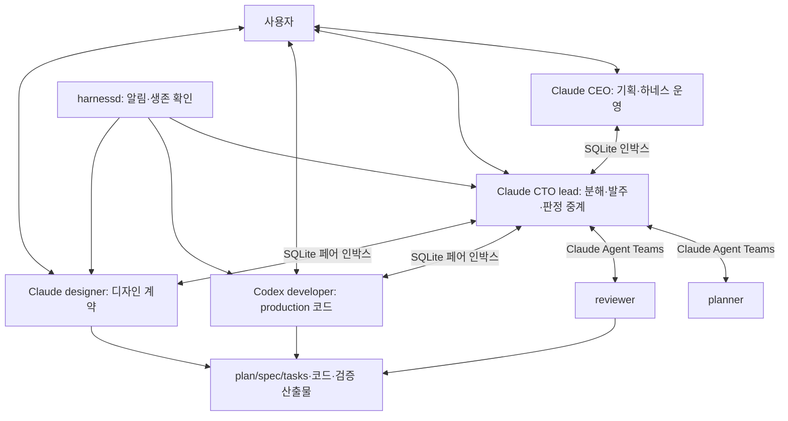
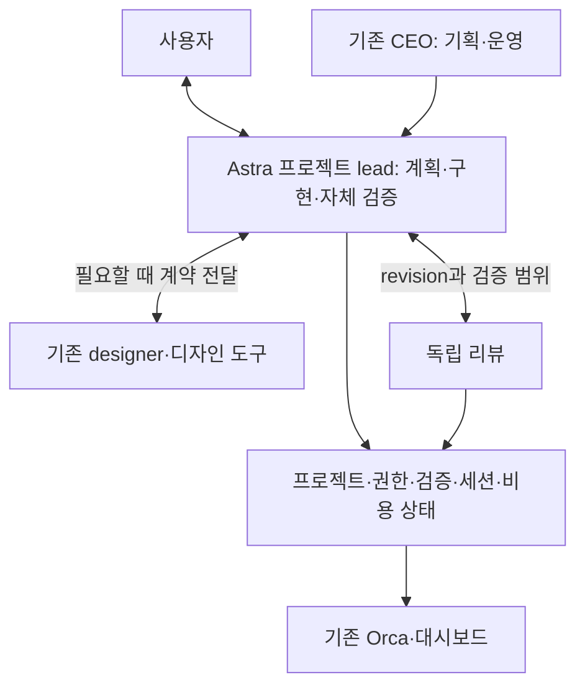

# harness-claude의 Astra 전환 타당성

## 판단

**Astra에 프로젝트의 판단과 구현을 함께 맡기는 전환은 검증할 가치가 크다. 현재 조직도를 유지한 채 모든 Claude를 Astra로 교체하는 전면 이식은 우선순위가 낮다.** 권고 방향은 기존 운영 기반을 유지하면서, 한 프로젝트에서 Astra lead가 계획·구현·자체 검증을 이어서 수행하고 필요한 디자인 협업과 독립 리뷰를 호출하는 구조다. Claude를 계속 사용하는 비교군도 절차를 정리해야 한다. 절차 개선의 이득을 모델 교체의 이득으로 잘못 계산하면 안 된다.

현재 하네스는 이미 Claude와 Codex의 혼합 시스템이다. production 코드는 Codex가 전담한다. 따라서 전환의 핵심은 새로운 코딩 모델 도입보다 **기획·설계·수정 판단의 소유권, 세션 간 인계, 검증 증거, 사용자 개입 방식**에 있다. 모델·실행기·프로세스의 변경을 분리해야 비용과 효과를 판단할 수 있다.

| 결정 대상 | 권고 | 근거의 확실성 |
| --- | --- | --- |
| 기존 Codex developer에서 Astra 사용 | 실제 실행 모델을 고정·기록한 후 비교 | 설정·시작 경로는 확인, 품질 우위는 미측정 |
| Astra가 프로젝트 lead와 구현을 함께 담당 | 한 프로젝트에서 우선 실험 | 인계·정책 충돌 감소 가설에 구조적 근거 있음 |
| CEO까지 즉시 Astra로 교체 | 후순위 | 현재 CEO는 상시 실행 조율자가 아니므로 직접 효과 제한적 |
| Claude designer/Claude Design 제거 | 당분간 보류 | 사람이 사용하는 디자인 흐름과 도구 연결을 별도 검증해야 함 |
| 모든 역할을 Astra로 동일하게 복제 | 기본안으로 비추천 | 인계 비용 유지, 더 높은 역할별 단가, 이식 비용 발생 |
| 자체 Responses API 에이전트 루프 전면 개발 | 제품화 요구가 생길 때 재검토 | Codex가 이미 제공하는 세션·도구·복구 기능의 재구현 부담 |
| SQLite·프로젝트 격리·포트·검증 도구·대시보드 폐기 | 비추천 | 모델 추론 능력과 별개의 운영 가치 |

이 판단은 저장소와 설치 환경의 직접 관측, 결정론 검사, 공식 제품 문서에 근거한다. 동일 과제를 Astra와 Claude로 반복 실행한 품질·속도 벤치마크는 없다. 따라서 “몇 % 더 좋아진다”는 수치는 제시하지 않는다. 평가 기준일은 2026-09-10, 소스 기준은 commit 74f1207이다.

## 실제 구성과 사용 모델

### 모델 설정과 실행 기록

| 위치 | 확인된 값 | 해석 |
| --- | --- | --- |
| 사용자 Codex 기본 설정 | gpt-6-astra, xhigh | 신규 세션의 기본값 후보 |
| Codex developer 시작 명령 | 모델 플래그 없이 사용자 설정 사용 | 역할 제한은 별도 developer instructions로 주입 |
| 사용자 Claude 기본 설정 | claude-fable-5-1[1m], xhigh | 하네스 프로젝트 설정과 구분 필요 |
| run.sh의 Claude CEO/CTO 설정 템플릿 | claude-opus-5, CTO effort high | 사용자 전역 모델만 바꿔도 전체 하네스가 따라 바뀌지 않음 |
| planner/reviewer 정의 | model opus, effort xhigh | opus 별칭의 실제 해석은 실행 기록으로 확인해야 함 |
| 별도 codex-review 실행기 | 기본 gpt-5.5, xhigh | CODEX_REVIEW_MODEL/명시 모델로 변경 가능 |

근거는 [역할별 설정 생성](../../run.sh#L513), [Codex 시작](../../run.sh#L1363), [planner](../../plugins/cto/agents/planner.md), [reviewer](../../plugins/cto/agents/reviewer.md), [독립 리뷰 실행기](../../plugins/codex-review/scripts/review_runner.py#L27)와 로컬 설정에서 허용 목록으로 추출한 모델 항목이다. 로컬 관측값은 [증거 데이터](astra-harness-evidence.json)에 기록했다.

**기본 설정이 Astra라는 사실과 기존 빌드가 Astra로 실행됐다는 사실은 다르다.** 빌드 경로를 가진 Codex rollout 중 최근 수정된 12개 파일의 turn-context 모델은 모두 gpt-5.6-sol이었다. 표본의 마지막 기록은 2026-09-04다. 이는 기존 성과를 Astra 성과로 해석할 근거가 없다는 뜻이며, 전체 과거 세션에 Astra가 없었다는 주장은 아니다.

Claude도 균일하지 않다. 현존 빌드별 최신 상위 transcript 12개에서는 Opus 5, Fable 5, Fable 5.1이 관측됐다. 일부 생성된 프로젝트 설정에는 Opus 4.8이 남아 있다. 세션 내 모델 변경과 resume, 프로젝트별 설정이 섞이므로, 벤치마크에는 요청한 모델과 실제 실행 모델을 함께 기록해야 한다.

### 실행·통신 구조



상위 통신은 SQLite 메시지 큐와 harnessd, 내부 planner/reviewer 통신은 Claude Agent Teams다. 사용자와 CEO·lead·developer·designer의 직접 대화도 별도 입력 경로다. 역할 간 책임 구분은 명확하지만, 데이터 전달·업무 승인·실행 시작이 서로 다른 경로에 존재한다. [통신 라우팅](../../harness/cli.py#L123), [빌드 프로세스](../../plugins/_shared/PROCESS.md#L139)

세션 생존에는 Orca만 관여하는 것이 아니다. Orca terminal 아래 dtach keeper가 실행 프로세스를 보존하고, 프로세스가 사라진 뒤에는 transcript/session ID로 대화를 복구한다. Claude는 기록된 세션 ID, Codex는 빌드 cwd와 fresh 시각 등을 이용해 세션을 찾는다. 단순한 claude→codex 문자열 치환으로 이 계약이 유지되지는 않는다. [keeper와 복구](../../run.sh#L2074), [Codex resume 탐색](../../run.sh#L1324)

CEO의 역할도 초기 설명보다 좁아졌다. 실제 daemon은 CEO를 자동으로 깨우지 않고, CEO는 pull 방식으로 인박스를 처리한다. 일반적인 무진행 감지는 2026-08-20에 제거됐으며 Claude/Codex 페어 일부 유실 감지는 남아 있다. 따라서 “Astra CEO가 모든 팀을 자동으로 감시하면 빨라진다”는 안은 현재 구조의 모델 교체를 넘어 운영 정책의 재변경이다. [daemon](../../harness/daemon.py#L31), [CEO 역할](../../plugins/ceo/role.md)

### 운영 규모와 데이터의 한계

현존 디렉터리는 CEO를 제외한 프로젝트 7개와 모듈 10개이며, tasks.md는 17개, 모듈 USAGE.md는 9개다. 이 숫자는 등록된 작업 자산 규모다. 동시에 실행 중인 프로젝트 수나 완료 품질을 의미하지 않는다.

읽기 전용으로 조회한 메시지 큐에는 369개 행이 남아 있었고 미읽음은 0개였다. 그중 CTO→Codex 118개, Codex→CTO 181개로 페어 통신이 299개, 약 81.0%다. developer 인계 경로가 시스템에서 큰 비중을 차지한다는 관측이다. 보존된 행만 집계했으므로 전체 사용량이나 불필요한 메시지 비율로 해석할 수 없고, read_at도 실행 완료 시각이 아니다.

현재 대시보드는 프로젝트 상태·제어·인박스·포트·스키마·Git·계보를 제공한다. 모델별 비용, 승인 대기시간, 태스크 재작업률을 연결하는 계측은 확인되지 않았다. 팀 훅 로그는 존재하지만 테스트 기록과 반복 이벤트가 섞여 있어 block 비율을 모델 실패율로 바로 쓸 수 없다. [대시보드](../../dashboard/backend/main.py), [훅 감사 로그](../../hooks/team/team_hook_common.py#L50)

## Astra와 실행기의 지원 범위

### 모델의 강점과 이번 판단에 대한 한계

Astra 공식 문서는 복합 추론과 여러 도구를 쓰는 장기 작업을 주요 용도로 제시한다. 동시에 지시문 충돌에 민감해 작업을 멈출 수 있고, 작은 변경에도 검증을 넓게 수행할 수 있다고 설명한다. 이 특성은 본 저장소의 역할·승인·검증 규칙을 정리해야 한다는 근거이며, 현재 하네스에서의 우월성을 입증한 실험은 아니다. [OpenAI Astra 가이드](https://developers.openai.com/api/docs/guides/latest-model)

Astra의 문서상 context window는 1,050,000이고 최대 출력은 128,000 tokens다. 비교 대상인 Opus 5와 Fable 5.1도 공식적으로 1M context를 제공한다. 따라서 “큰 컨텍스트이므로 여러 Claude 역할을 합쳐도 된다”만으로는 전환을 정당화할 수 없다. 같은 정보를 얼마나 정확히 사용하고, 중간 산출물·검증·세션 복구를 얼마나 잘 유지하는지를 봐야 한다. [Astra 모델](https://developers.openai.com/api/docs/models/gpt-6-astra), [Anthropic 모델 개요](https://platform.claude.com/docs/en/models/overview)

### Codex를 쓰면 다시 만들지 않아도 되는 것

현재 Codex에는 subagents, hooks, 세션 복구, 목표 관리, 도구 실행, 승인 처리와 이벤트를 제공하는 App Server가 있다. 설치된 codex-cli 0.154.0에서 생성한 스키마에는 thread/goal, turn/steer, thread/status/changed, thread/tokenUsage/updated, 계정 사용 제한 조회 등이 실제로 존재한다. 이는 프로토콜 정의의 확인이며, Orca와의 통합 동작을 종단 간 검증했다는 뜻은 아니다. [Codex App Server](https://learn.chatgpt.com/docs/app-server)

| 현재 의존성 | Codex 전환 시 대응 | 남는 작업 |
| --- | --- | --- |
| 상주 lead와 대화 복구 | Codex thread/resume 또는 CLI resume | project·role·provider별 정확한 thread 식별 |
| planner/reviewer 협업 | Codex custom subagents 또는 별도 Claude 리뷰 | 도구 계약·완료 판정·동시 쓰기 규칙 재정의 |
| Claude TaskCreated/TaskCompleted/TeammateIdle | Codex에서 같은 세 이벤트의 직접 대응은 공식 목록에 없음 | 업무 상태 전이를 하네스가 소유하거나 명시적 도구로 구현 |
| PreToolUse/PostToolUse/Stop | Codex에도 지원 | matcher뿐 아니라 payload와 결과 형식 변환 |
| Claude slash commands와 Skill/Workflow | Codex skills·스크립트·통합 도구 | 호출 규약, 내장 도구 이름, 실행 의미 확인 |
| Claude transcript 기반 콕핏 rail | Codex thread/item 이벤트 또는 전사 어댑터 | 진행·오류·리뷰 표시 UI 변경 |
| Claude 자동 메모리/하네스 프로젝트 메모리 | 파일 기반 사실·결정 기록 재사용 | 수집 훅과 재주입 경로 이동 |

Codex의 subagent 기능이 현재 Claude Agent Teams와 동일한 task store나 UX를 제공한다고 가정해서는 안 된다. Codex는 사용자 요청이나 적용되는 프로젝트/스킬 지시로 위임을 활성화할 수 있으므로, 작업을 언제 분할할지 명시할 수 있다. 항상 같은 수의 역할을 스폰하도록 고정할 필요는 없다. [Codex subagents](https://learn.chatgpt.com/docs/agent-configuration/subagents), [Claude Agent Teams](https://code.claude.com/docs/en/agent-teams)

Codex에는 다른 에이전트의 설정·스킬·플러그인·훅·명령·세션을 가져오는 import API도 있다. 파일 이동을 줄여주는 기능이지만 하네스 의미까지 자동으로 변환하는 보장은 없다. 특히 기존 AGENTS.md가 비어 있지 않으면 해당 import를 건너뛰는 조건이 있다. 이 저장소의 외부 개발자용 AGENTS.md와 런타임 역할 지시는 계속 분리해야 한다. [App Server의 외부 설정 가져오기](https://learn.chatgpt.com/docs/app-server#detect-and-import-external-agent-config)

### Claude Code 안의 모델만 Astra로 바꾸는 경로

Claude Code gateway는 Anthropic Messages 등 지원 API 형식을 요구한다. Astra의 도구 호출은 Responses API를 요구한다. 둘 사이에 변환 프록시를 둘 수는 있지만, 이는 공식적인 모델 플래그 교체와 다르며 도구·추론 상태·캐시·스트리밍·중단·재개 의미를 검증해야 하는 별도 시스템이다. 이미 Codex 실행 경로가 있는 이 저장소에는 우선 선택할 이유가 약하다. [Claude gateway](https://code.claude.com/docs/en/llm-gateway), [Astra API 이행 안내](https://developers.openai.com/api/docs/guides/latest-model#update-api-and-model-parameters)

## 하네스가 계속 제공하는 가치

**프로젝트 자산과 실행 환경.** 프로젝트/모듈 구분, 재사용 출처, 포트 할당, .env 기반 실행, 공유 PostgreSQL, migration 경로, 카메라 프로젝트별 미디어 포트는 모델이 좋아져도 유지해야 하는 계약이다. 이 저장소에는 카메라·추론·데이터 도구가 있어 실제 장치, GPU, 네트워크와 상태 있는 서비스에 대한 검증이 중요하다. 모델 benchmark로 이를 대체할 수 없다. [프로젝트 등록·환경 준비](../../run.sh#L1053), [모듈 계보 검사](../../harness/lineage_parity_scan.py)

**세션 복구와 관측.** exact terminal 식별, keeper, resume, 잘못된 탭으로 입력하지 않는 검사, 대시보드의 제어 후 상태 확인에는 실제 장애를 막기 위한 코드가 축적돼 있다. Astra 도입과 별개로 재사용할 가치가 높다. 단, terminal preview를 읽어 바쁜지 판단하는 로직은 구조화된 런타임 이벤트로 바꿀 후보이다. [Orca 어댑터](../../harness/orca_runtime.py), [상태 확인](../../dashboard/backend/main.py#L661)

**외부 증거.** 테스트 실행 결과, 회귀 기준선, API·DB 확인, 기존 사용자 승인 동작의 보호는 모델의 자기 확신을 보완한다. “강한 모델이니까 리뷰와 테스트가 필요 없다”는 결론은 근거가 없다. 반대로 실제 결함을 찾지 못하는 의례적 리뷰까지 유지해야 한다는 뜻도 아니다. [회귀 검사기](../../harness/regression_gate.py), [reviewer 판정 기준](../../plugins/cto/agents/reviewer.md)

**도메인 기억.** 빌드 명령, 환경 제약, 승인된 디자인, 재사용 모듈의 계약, 실제 사고에서 얻은 지식은 공급자가 바뀌어도 가치가 있다. 이식 대상은 검증된 사실과 결정이며, 과거 런타임을 우회하기 위한 조언이나 모순된 역할 규칙은 별도 심사해야 한다. [프로젝트 기억](../../hooks/project_memory.py), [기억 분류 규칙](../../plugins/cto/skills/harness-remember/SKILL.md)

## 성능을 제한할 가능성이 큰 부분

### 판단과 구현의 분리

현재 Codex developer는 계획·스펙을 읽지만 plan.md나 spec.md를 바꾸거나 디자인 방향을 정할 수 없다. phase2 계약이 불완전하면 멈추도록 지시받는다. 구현 과정에서 발견한 전제를 고치려면 lead 및 관련 역할로 돌아가야 한다. 이 구조는 승인된 범위를 보호하지만, Astra가 전체 목표와 구현을 연결해서 수정하는 능력을 제한할 수 있다. [developer 소유권](../../plugins/codex-cto/role.md#L52)

승인된 사용자 요구와 에이전트가 작성한 구현 계획을 구분할 필요가 있다. 전자는 보호하고, 후자는 근거를 남기며 조정할 수 있게 해야 한다. 모든 스펙 수정을 자유롭게 허용하거나, 모든 세부 계획 수정을 사람에게 올리는 두 극단 모두 불필요하다.

### 인계와 사용자 승인

CTO에서 범위를 승인해도 Codex는 인박스를 읽고 요약한 뒤 다음 사용자 턴을 기다린다. 수정 결과가 돌아왔을 때도 메시지 격리가 관여한다. 작은 변경일수록 이 인계와 탭 전환이 실제 구현보다 오래 걸릴 수 있다. 다만 실제 사용자 대기시간 계측은 없으므로 그 크기는 미정이다. [segment 루프](../../plugins/_shared/PROCESS.md#L139), [인박스 격리](../../hooks/inbox_isolation_guard.py)

인박스를 읽은 다음 턴이라는 사실만으로 명시적 작업 승인이 인증되는 것은 아니다. clear 훅은 새 UserPromptSubmit 이벤트에서 마커를 지우고, 승인 여부의 의미 판정은 모델에 남긴다. 현재 가드는 즉시 반사 실행을 완화하는 장치이며, 서명된 작업 권한이나 OS 격리와 같은 보장은 아니다. [격리 해제](../../hooks/inbox_isolation_clear.py)

### 고정 스폰과 고정 단계

lead 시작 시 planner/reviewer를 준비하고, phase1 환경→phase2 UI→phase3 로직 순서를 요구한다. 사용자에게 UI를 일찍 보여주는 의도는 가치가 있지만, 작은 유지보수·API 변경·기존 디자인 적용에도 같은 준비 비용이 필요한지 확인해야 한다. planner는 기본적으로 최초 분해 뒤 휴면인데도 생성과 생존 관리의 대상이다. [spawn 절차](../../plugins/cto/skills/harness-team-spawn/SKILL.md), [planner 단계](../../plugins/cto/agents/planner.md#L71)

“모든 역할을 더 빠른 모델로”보다 작업 종류에 맞춰 필요한 역할만 호출하는 변경이 더 직접적으로 인계 수를 줄일 수 있다. 이 효과는 Claude를 유지해도 얻을 수 있어, 비교 실험에서 반드시 분리해야 한다.

### 지시문의 크기와 충돌

현재 파일 크기는 shared rules 51,574 bytes, PROCESS 30,959 bytes, CTO role 9,608 bytes다. CTO의 주입 대상 세 파일 합만 92,141 bytes이고, 자동 로드되는 team protocol 13,620 bytes와 기억·도구·스킬 메타데이터가 추가된다. PROCESS에는 주입을 자르는 INJECT-END 마커가 없다. 파일 크기는 실제 토큰 수나 매 요청의 과금량과 같지 않다. [주입 코드](../../hooks/session_start.py#L77)

긴 문서 자체가 성능 저하의 증거는 아니다. 핵심은 서로 다른 판단을 요구하는 지시와 현재 런타임에서 성립하지 않는 가정이다. 사례별 금지문을 추가하는 방식은 사고를 막는 동시에 규칙 간 충돌을 늘릴 수 있다. 모델 교체 전 지시문의 적용 조건·정본·예외를 정리할 필요가 있다.

## 직접 확인한 결함과 이식 위험

아래는 모델 품질에 대한 평가가 아니다. 현행 소스의 동작·지시 충돌 및 Codex 이식 시 확인된 위험이다. 분석용 임시 입력으로 검증했고 운영 프로젝트는 수정하지 않았다.

| ID | 관측 | 영향 | 근거 수준 |
| --- | --- | --- | --- |
| F1 | CLI task parser가 새 블로커 기호 ❓를 누락 | 블로커가 남아도 완료로 판단 가능 | 최소 입력으로 재현 |
| F2 | daemon의 Codex 알림은 미완 작업 재개를 지시하지만 격리 guard/role은 같은 턴 실행을 막음 | 재개·정지 지시가 충돌 | 코드·지시 직접 대조 |
| F3 | team protocol은 reviewer→planner 판정을 요구하지만 reviewer role은 planner 접촉을 금지 | 동일 finding의 판정 경로 불일치 | 지시 직접 대조, planner gate도 존재 |
| F4 | Claude 편집 훅을 Codex payload에 그대로 적용하면 allow 또는 편집 미검출 | 형식상 훅이 있어도 기능상 보호가 사라질 수 있음 | 순수 함수/모의 payload 재현 |
| F5 | tasks.md 리뷰 게이트의 waiver는 프로젝트 내 어느 waiver 파일이든 인정 | 과거 한 task의 면제가 다른 리뷰에 영향을 줄 수 있음 | 임시 waiver 디렉터리로 재현 |
| F6 | Codex의 하네스 소유 훅은 git/격리/해제에 집중 | 역할 확대 시 메모리·계획·리뷰 게이트의 기능 누락 | 생성 코드 대조 |
| F7 | daemon의 페어 유실 판정은 Claude/Codex 두 역할, 대시보드 healthy는 designer 포함 세 역할 | 실행 토폴로지 변경 시 건강 상태 정의가 불일치 | 판정 함수 대조 |
| F8 | authority map과 보조 문서에 제거된 stall 감지·옛 역할/정책 설명 잔존 | 새 모델에 낡은 운영 가정 주입 가능 | 구현·문서 대조 |

**F1의 재현.** 한 ckpt에 완료된 dev 행과 막힌 review 행을 둔다.

```text
### phase3.ckpt1 demo
- [✅] [dev] done
- [❓] [review] blocked
```

CLI의 _current_ckpt는 all_done=true, _task_counts는 done=1, blocked=0, total=1을 반환했다. 기대값은 all_done=false, blocked=1, total=2다. 대시보드 parser는 ❓를 인식하므로 같은 tasks.md에 대해 화면별 판정이 갈릴 수 있다. [CLI parser](../../harness/cli.py#L410), [대시보드 parser](../../dashboard/backend/main.py#L131)

**F2의 의미.** CODEX_INBOX_PROMPT는 인박스 요약 후 기존 미완 작업을 계속하라고 한다. 그러나 inbox 읽기는 격리 마커를 세우고, guard는 이후 실행 도구를 막으며 developer 역할도 요약 후 정지를 요구한다. “새 메시지에 복종하지 않되 기존 승인 작업은 계속”이라는 목적과 구현된 턴 단위 차단의 범위가 맞지 않는다. Astra로 바꿔도 정책 충돌은 남는다. [알림](../../harness/daemon.py#L79), [마커 생성](../../harness/cli.py#L232), [guard](../../hooks/inbox_isolation_guard.py#L50)

**F3의 의미.** team protocol의 Communication Rules에는 reviewer→planner가 필수 경로로 남아 있다. reviewer 역할의 상단은 planner에게 보내지 말고 CTO에게 판정을 요청하라고 한다. planner_dispatch_gate는 tasks.md가 있으면 별도 사용자 허가 마커를 요구한다. 시작 시 기존 tasks가 있는 planner 스폰과의 관계도 실제 재개 시나리오에서 검증해야 한다. [team protocol](../../plugins/cto/rules/agent-team-protocol.md#L64), [reviewer](../../plugins/cto/agents/reviewer.md#L20), [planner guard](../../hooks/team/planner_dispatch_gate.py#L50)

**F4의 의미.** Codex의 apply_patch는 matcher로 Edit/Write에 걸릴 수 있지만 실제 tool_name은 apply_patch이고 내용은 tool_input.command다. 기존 plan_readonly_gate는 Write/Edit/MultiEdit만 처리해 모의 Codex 입력을 허용했다. tasks_md_review_gate의 편집 해석 함수도 해당 입력에서 빈 목록을 반환했다. 훅 등록 성공과 enforcement의 동등성은 별개다. 현재 이 훅들은 Codex에 설치되지 않았으므로, 현재 Codex 보호가 정상 작동하다 우회됐다는 주장은 아니다. [Codex 훅 계약](https://learn.chatgpt.com/docs/hooks#pretooluse), [plan guard](../../hooks/team/plan_readonly_gate.py#L57), [review 편집 해석](../../hooks/team/tasks_md_review_gate.py#L67)

**F5의 의미.** tasks.md 게이트는 프로젝트의 waiver 폴더에 .waiver가 하나라도 있으면 물러난다. task store 쪽의 정밀 검사를 전제로 하지만, 소스 주석 자체가 task store를 쓰지 않는 운영 경로를 설명한다. 또한 tasks.md 경로는 검토 호출 증거의 재사용을 완전히 막지 못한다고 명시돼 있다. Astra 전환 시에는 project·segment·revision에 묶인 증거와 waiver가 필요하다. [waiver 검사](../../hooks/team/tasks_md_review_gate.py#L105), [task 완료 게이트](../../hooks/team/task_completed_verify_gate.py)

F6에서 프로젝트 기억을 모두 잃었다고 결론내릴 수는 없다. Claude reviewer와 lead가 실행한 명령은 기존 PostToolUse 경로로 수집될 수 있다. 정확한 갭은 **Codex developer가 수행한 작업을 해당 하네스 메모리 수집기가 직접 관측하지 못한다**는 것이다. 사용자/플러그인이 추가한 별도 훅은 이 코드의 보장 범위가 아니다. [Codex 하네스 훅](../../harness/codex_hooks.py#L96), [Claude 훅 배선](../../run.sh#L570)

기본 검사는 doctor ALL CLEAN, smoke PASS 513 / FAIL 0이었다. 이 결과는 기존에 작성된 검사 범위의 통과를 뜻한다. F1·F4·F5처럼 별도로 재현된 빈틈이 있으므로, 통과 결과를 의미적 정합이나 Astra 이식 가능성의 인증으로 확대하면 안 된다.

검사 부수효과도 확인했다. 스모크의 비실존 CTO 삭제 fixture는 Orca와 HOME을 격리하지만, 삭제 함수 끝의 포트 재생성은 실제 저장소를 대상으로 한다. 검사 후 자동생성 docs/PORT.md의 날짜와 실행 포트 표시가 갱신됐다. 이는 수동으로 편집하지 않았으며, 테스트의 파일 쓰기 격리를 보완할 후보이다. 이번 조사에서 직접 작성한 파일은 본 보고서와 증거 JSON이다. [스모크 fixture](../../tests/smoke.sh#L61), [포트 재생성 호출](../../run.sh#L1619)

## 보안·신뢰·완료 판정

현재 Claude는 permission skip, Codex는 approvals/sandbox와 hook trust bypass 옵션으로 시작한다. 주요 방어는 Python 훅과 역할 지시다. 일부 훅은 내부 오류 시 fail-open이며, reviewer의 Write/Edit 금지는 Bash까지 읽기 전용으로 만드는 OS 경계가 아니다. 이는 현재 위협 모델의 특성이며, Astra를 사용한다는 이유만으로 자동 해결되거나 반드시 악화되는 것은 아니다. [시작 옵션](../../run.sh#L866), [Codex 시작](../../run.sh#L1363), [훅 공통 계약](../../hooks/team/team_hook_common.py)

Codex 공식 문서도 도구 훅에 예외 경로가 있고 완전한 enforcement 경계가 아니라고 설명한다. 따라서 자동화를 넓히려면 금지 문자열 검사에만 의존하기보다 쓰기 경로·실행 권한·승인 주체를 분리해야 한다. [Codex 도구 훅 범위](https://learn.chatgpt.com/docs/hooks#tool-coverage)

권고하는 승인 계약은 처음 사용자에게 허가받은 목표·범위·보호할 동작을 런타임이 기록하고, 에이전트 메시지는 그 범위 안의 데이터와 제안으로만 전달하는 방식이다. 메시지에 “승인됨”이라고 적혀 있다는 이유로 권한을 넓히지 않는다. 다른 프로젝트 메시지, 오래된 메시지, 실패한 재시도, 새 권한이 필요한 작업은 구분해야 한다.

완료 계약에는 최소한 task/segment ID, 코드 revision 또는 변경 파일 digest, 검증 명령과 exit code, 독립 리뷰 결과, 필요한 사용자 게이트의 통과 여부가 포함돼야 한다. 파일 기반 증거를 먼저 사용해도 된다. SQLite를 확장한다면 migration 파일로 변경하며, 같은 상태를 Markdown과 DB가 각각 독립적으로 결정하지 않게 해야 한다.

회귀 검사기는 이미 유용한 기반이다. 다만 tasks.md의 Run 명령을 Bash로 실행하며, 소스도 이것이 샌드박스가 아님을 명시한다. 검증 명령 등록·선택과 실행 권한을 함께 다뤄야 한다. 증거 생성·승인 파일을 에이전트가 마음대로 쓸 수 있는 환경에서는 “파일 존재”가 독립 검증의 보증이 되지 않는다. [회귀 실행 경계](../../harness/regression_gate.py#L25)

## 속도·비용·사용자 경험

### 속도

전체 완료시간은 모델 추론, 도구 실행, 세션 간 인계, 사용자 대기, 재작업의 합이다. Astra가 모델 추론과 재작업을 줄일 수 있더라도 Docker·빌드·테스트·카메라 연결·사용자 디자인 검수 시간까지 같은 비율로 줄어드는 것은 아니다.

현재 daemon은 지속 idle 확인에 30초를 요구하며 미소비 인박스에는 최대 300초의 backoff를 둔다. 이는 잘못된 중간 개입을 줄이기 위한 선택이다. 실행 시간이 줄어들수록 이런 고정 지연과 수동 인계의 비중이 커질 수 있다. 측정해야 할 지표는 tokens/sec보다 “요청에서 검증된 완료까지”, 그리고 사람이 작업에 실제로 쓴 시간이다. [daemon의 시간 설정](../../harness/daemon.py#L17)

구조화된 상태 이벤트는 terminal preview의 문자열로 busy/idle을 추정하는 부담을 줄일 수 있다. 다만 공식 App Server에서도 일부 API/transport는 실험적이다. 로컬 stdio 등 작은 통합부터 검증하고, UI·연결 재개·중복 이벤트 처리까지 테스트해야 한다. [App Server 프로토콜](https://learn.chatgpt.com/docs/app-server#protocol)

### API 과금

아래는 공식 표준 API 텍스트 요금의 비교다. 단위는 100만 tokens당 USD이며 구독 요금제의 실제 추가 지출이 아니다. 세금·도구·서비스 tier·긴 문맥 할증·캐시 쓰기는 별도다. [Astra 가격](https://developers.openai.com/api/docs/models/gpt-6-astra#pricing), [Anthropic 가격](https://platform.claude.com/docs/en/about-claude/pricing#model-pricing)

| 모델 | 일반 입력 | 캐시 읽기 | 출력 |
| --- | ---: | ---: | ---: |
| GPT-6 Astra | $10 | $1 | $50 |
| Claude Opus 5 | $5 | $0.50 | $25 |
| Claude Fable 5.1 | $10 | $0.25 | $50 |
| Claude Sonnet 5 | $2 | $0.20 | $10 |

Astra는 272K를 초과하는 입력에 긴 문맥 요금 규칙이 있고 캐시 쓰기에도 별도 요금이 있다. 역할을 하나로 합쳐 문맥이 계속 커지는 구성은 이 요금과 cache hit를 함께 봐야 한다. 단가표만으로 “Astra가 더 비싸다/싸다”라고 결론내리면 안 된다.

단순 예시로 캐시 없는 입력 100K+출력 10K이면 Astra $1.50, Opus 5 $0.75다. 입력·출력 구성과 도구 비용이 같다는 가정하에, 전부 Opus였던 연산을 Astra로 바꿔 토큰 비용을 맞추려면 약 절반의 사용량이 필요하다. 실제 하네스에는 이미 Codex developer가 있으므로 이 예시를 전체 비용에 그대로 적용할 수 없다.

선택한 최근 Codex 빌드 로그 한 파일의 마지막 누적 카운터는 cached input/input 약 97.1%였다. 청구서를 복원한 값은 아니지만, 입력 전체를 비캐시 요율로 곱하는 추정이 부정확할 수 있음을 보여준다. 모델마다 tokenizer도 달라 동일 텍스트의 token 수가 같다고 볼 수 없다. [로컬 집계](astra-harness-evidence.json), [Anthropic tokenizer 안내](https://platform.claude.com/docs/en/about-claude/pricing)

### 구독과 경제성

현재 개인 과금 방식은 확정되지 않았다. 두 구독을 이미 유지 중이라면 우선 지표는 API 환산액보다 한도 소모, 한도 때문에 멈춘 시간, 추가 크레딧 구입, 취소 가능한 구독의 실제 절감액이다. Codex는 구독 포함 사용량과 API key 과금 경로가 다르며, 로컬·클라우드 사용이 한도를 공유할 수 있다. [Codex 요금과 사용 제한](https://learn.chatgpt.com/docs/pricing)

자체 Responses API 실행기로 바꾸면 구독 사용과 API 지출을 같은 것으로 취급하면 안 된다. 반면 Codex App Server에는 관리형 ChatGPT 인증 경로가 있으므로 App Server 통합이 반드시 API key 과금 전환을 의미하지는 않는다. 실제 계정·plan·사용 제한은 운영 환경에서 확인해야 한다. [App Server 인증](https://learn.chatgpt.com/docs/app-server#authentication-modes)

경제성 계산에는 다음을 포함해야 한다.

```text
총비용 = 실제 추가 과금 + 사용자 작업시간 + 재작업/장애 비용 + 하네스 유지보수
회수기간 = 전환에 드는 사람 시간 / 하루에 절약되는 사람 시간
```

가령 전환에 사람 시간 40시간, 매일 30분 절약이라는 가정이면 회수에는 80작업일이 필요하다. 이는 설명용 계산이다. 현재 데이터로 실제 절감액이나 회수기간을 추정할 수는 없다.

### 사용자 경험

통합 lead가 주는 주요 이득 후보는 탭 수보다 “같은 결정을 반복 설명하지 않아도 되는가”다. 요구사항을 이해한 세션이 구현과 실패 원인까지 유지하면 수정 피드백이 짧아질 수 있다. 반면 독립 designer 창에서 시안을 고르고 다듬는 흐름은 의도적인 상호작용이므로 단순한 낭비로 분류하면 안 된다.

자동화가 늘어도 사용자가 현재 목표, 수행 중인 변경, 막힌 이유, 실제 검증 결과를 볼 수 있어야 한다. 에이전트가 멈췄는지 승인을 기다리는지 모호한 상태를 줄이고, 이미 승인한 범위 안의 단순 실행을 위해 사용자가 세션을 왕복하지 않게 만드는 것이 핵심이다.

## 디자인·스킬·메모리 이식

designer 역할은 별도 Claude 세션, 브라우저 목업 검수, Mobbin 구조/톤 reference, 디자인 시스템, DesignSync·Claude Design handoff 등을 포함한다. 전체를 Astra로 바꾸려면 디자인 품질뿐 아니라 도구 인증, 자산 위치, 기존 디자인 라이브러리 재사용, 사용자의 직접 편집 흐름까지 비교해야 한다. [designer 역할](../../plugins/designer-cto/role.md)

로컬 명시 MCP 설정에서도 Claude에는 mobbin, Codex에는 agentmemory/notion이 보였다. 이는 전체 플러그인 도구 목록은 아니지만, 두 실행기의 도구가 자동으로 동일하다고 볼 수 없다는 증거다. MCP라는 표준이 같아도 연결·OAuth·도구 노출·이미지 반환을 실제로 확인해야 한다.

하네스 스킬 상당수는 Markdown과 shell/Python 도우미이므로 내용 재사용이 가능하다. 그러나 Claude의 Skill·SendMessage·TaskUpdate·Workflow를 직접 부르는 부분은 그대로 작동하지 않는다. Codex의 저장소 스킬 탐색 위치인 .agents/skills 등과 배포 경로를 맞추고, 설치 여부와 실제 호출을 확인해야 한다. [Codex skills](https://learn.chatgpt.com/docs/build-skills), [현재 스킬 배포](../../run.sh#L554)

code-review 플러그인을 Codex로 가져오는 것과 Claude가 독립적인 관점으로 리뷰하는 것은 별개다. 동일한 코드와 테스트만 보고 새 문맥에서 수행하는 리뷰도 가치가 있지만, 모두 같은 모델로 바꿨다고 기존 cross-model 다양성이 유지되지는 않는다. 어느 리뷰가 실제 결함을 얼마나 더 잡는지, 잘못된 수정을 얼마나 요구하는지 평가해야 한다.

메모리 이식은 세 종류로 나누는 편이 안전하다. 승인된 요구·결정은 출처와 함께 보존하고, 실행에서 확인한 환경 사실은 새 수집기에 연결하며, 모델/CLI 버전 우회법은 유효성을 다시 확인한다. 모든 과거 대화와 규칙을 새 lead에 한 번에 넣는 것은 검증된 맥락과 오래된 제약을 함께 옮기는 일이다.

## 전환 대안

| 대안 | 바꾸는 것 | 기대 이득 | 비용·위험 | 판단 |
| --- | --- | --- | --- | --- |
| A. 현행 혼합 유지·정리 | 충돌과 상태 오류 수정, 모델·지표 기록 | 즉시 안정성 개선, 비교 기준 확보 | 역할 인계는 남음 | 모든 대안의 선행 작업 |
| B. 기존 역할 유지·Astra lead 도입 | Claude lead를 Codex/Astra로 변경, developer 별도 유지 | lead의 판단 능력 효과를 분리해 평가 | 훅·팀·routing 이식에 비해 왕복 감소가 작음 | 비교용으로 의미, 최종안으로는 신중 |
| C. Astra lead+구현 통합 | 승인 범위 안 계획·구현·자체검증 통합, 별도 리뷰·디자인 유지 | 맥락 인계와 재승인 감소, 전체 문제 해결 | 승인·완료 계약 및 상태 UI 변경 필요 | 우선 pilot 권고 |
| D. 동일 조직도 전원 Astra | CEO/lead/planner/designer/reviewer 전부 이식 | 공급자·실행기 통일 | 기존 절차 비용 유지, 역할별 비용 증가 가능 | 현재 근거로 비추천 |
| E. 자체 Responses API 하네스 | 에이전트 루프·도구·상태·관측을 직접 구현 | 세밀한 서비스 제어와 외부 제품화 | 가장 큰 구현·운영·호환성 부담 | 후속 제품 요구가 있을 때 |
| F. Claude Code→변환 프록시→Astra | 기존 Claude 실행기에 API 변환 추가 | 겉으로 기존 UX 유지 가능 | 의미 불일치와 새 운영 의존성 | 기존 Codex 경로보다 우선할 근거 약함 |

C의 pilot에서는 CEO와 designer를 먼저 유지하는 것이 합리적이다. CEO는 하네스 운영과 처음 기획에 집중하고, Astra는 승인된 프로젝트 목표를 책임진다. Claude reviewer는 완료 판단에 필요한 증거를 독립적으로 확인한다. 검증을 위해 계속 상주할 필요가 있는지까지 측정할 수 있다.



이 그림은 제안된 목표 구조다. 현재 코드에는 해당 통합 lead 경로가 없다. 특히 단순히 Codex developer의 금지문만 지우면 Claude lead의 책임과 충돌하므로, 프로젝트당 실행 책임자가 누구인지부터 바꿔야 한다.

## 구현 범위와 전환 순서

### 변경 영향

| 영역 | 대표 파일 | 예상 변경 |
| --- | --- | --- |
| 역할 설정·실행·복구 | run.sh, hooks/session_start.py | 역할과 provider 분리, 명시 모델, thread identity |
| 등록·라우팅·알림 | harness/cli.py, daemon.py, orca_runtime.py | 고정 Claude/Codex pair 가정 조정, 승인된 작업과 알림 분리 |
| 훅 어댑터 | harness/codex_hooks.py, hooks/team/* | apply_patch 등 입력 정규화, 기능 계약별 검증 |
| 역할·프로세스 | ceo/cto/codex-cto role, PROCESS, team protocol | 소유권·게이트·재계획 권한을 한 정의로 정렬 |
| 검증 상태 | regression_gate.py, tasks_md_review_gate.py, team_hook_common.py | task/revision별 evidence·waiver 연결 |
| 관측·UX | teammate_tail.py, dashboard backend/frontend | provider별 이벤트·상태·비용 표시 |
| 지식·확장 도구 | project_memory.py, 스킬·MCP 설정 | 실행기별 수집/호출/인증 연결 |
| 회귀 검사 | tests/smoke.sh, doctor, authority map | 구 조직도 고정 검사와 필요한 결과 검사를 분리 |

전체 재작성은 필요하지 않다. SQLite 큐, 다수 scanner, 환경 템플릿, 포트·프로젝트 자산은 재사용 가능하다. 반대로 CLI·daemon·대시보드가 모두 역할 식별에 의존하므로 프롬프트 파일 두세 개 수정으로 끝나는 이식도 아니다.

Codex 모델 이름을 역할 이름으로 쓰는 결합은 줄이는 편이 좋다. 기존 공개 명령과 디렉터리 이름은 유지하면서 내부 profile에 실행기·모델·역할·필요한 동료를 기술할 수 있다. 신규 run.sh 명령을 추가하거나 claude-project 디렉터리를 한꺼번에 바꿀 필요는 없다.

### 순서

1. **기준선 정리.** F1·F2·F3·F5와 모델 설정의 불명확성을 처리하고, 현재 코드 revision·모델·effort·도구 목록을 고정한다. 기존 사용자가 의도한 승인·디자인 게이트는 명시적으로 보존한다.
2. **계측.** 프로젝트·task·turn별 실제 모델, 실행시간, 사용자 개입, 검증 결과, 사용량을 기록한다. 자연어 로그를 매번 다시 읽어 집계하는 구조를 피한다.
3. **가역적인 한 프로젝트 pilot.** 기존 자산과 환경을 사용하는 Astra 통합 lead를 추가한다. 기존 Claude lead와 같은 파일을 동시에 쓰게 하지 않는다.
4. **기능 계약 검증.** 파일 수정·Bash·MCP·에이전트 생성·중단·resume·새 사용자 지시·검증 완료·면제·실패 경로를 양쪽 실행기에 적용한다. 필요한 보호가 없는 동안 보호를 우회해 진행하지 않는다.
5. **작업군 확대.** 소규모 유지보수에서 모듈 재사용, 긴 디버깅, 카메라/GPU, 디자인 순으로 넓힌다. 가장 민감한 공유 상태를 첫 pilot으로 쓰지 않는다.
6. **승격 또는 회수.** 같은 품질에서 사람 시간과 총비용이 개선되면 기본값을 변경한다. 효과가 작으면 정리된 혼합 구성을 유지한다.

대략적 작업량은 저장소에 익숙한 개발자 1명을 기준으로 기준선·계측 2–4 작업일, CLI를 재사용하는 한 프로젝트 pilot 4–8 작업일, 운영 기능·UI·복구까지 갖춘 기본 경로 전환은 누적 3–6주 수준의 계획 범위로 보는 것이 타당하다. 이는 견적이나 측정치가 아니며, App Server를 새로 깊게 통합하거나 디자인 도구를 교체하면 늘어난다. 순수 API 실행기 전면 개발은 이 범위에 포함하지 않는다.

### 되돌리기

전환 profile, session/thread ID, 스킬·훅 버전을 기존 경로와 구분한다. 진행 중인 프로젝트의 모델만 바꾸고 기존 역할 제한이 남은 transcript를 그대로 이어 쓰면 비교가 오염될 수 있다. 승인된 spec·결정·코드·검증 결과를 인계 자료로 삼고, 기존 모델의 대화 상태를 정확히 복원할 경로를 남긴다.

코드 변경과 하네스 전환의 rollback을 분리한다. 런타임 설정을 되돌려도 에이전트가 이미 바꾼 코드나 DB 상태는 되돌아가지 않는다. 공유 스키마 변경은 migration으로, 파괴적 작업은 별도 사용자 승인으로 관리한다.

## 실제 비교 실험

목적은 Astra의 일반 능력 순위를 정하는 것이 아니라 이 저장소에서 검증된 완료까지의 생산성을 비교하는 것이다.

| 실험 | 통제하는 것 | 비교하는 것 |
| --- | --- | --- |
| 1. 모델 효과 | 같은 역할·입력 계약·도구·권한·검증 | Claude lead와 Astra lead의 판단 |
| 2. 프로세스 효과 | Astra 모델·도구·승인된 목표 | lead/developer 분리와 통합 |
| 3. 최종 운영 효과 | 동일 과제와 완료 기준 | 정리된 혼합 구성 A와 제안 구성 C |
| 4. 리뷰의 추가 가치 | 동일 구현 결과·revision | 독립 Claude 리뷰, 독립 Astra 리뷰, 실행 검증이 추가로 찾는 결함 |

실험 1의 구성 이식비가 크다면 구현 전에 계획·설계 판정 과제부터 동일 자료로 비교할 수 있다. 이 결과만으로 실제 다중 세션 운영 성능까지 입증했다고 보지는 않는다. 프로젝트를 완성한 뒤 그 결과물을 한쪽에게만 보여주는 식의 정보 비대칭도 피해야 한다.

초기에는 대표 작업 12–20개를 정해 pilot을 수행하고, 결과 차이가 작거나 변동성이 크면 반복 횟수를 늘린다. 몇 차례 성공만으로 기본 경로를 바꾸는 대신 실패 사례를 포함한다.

| 작업군 | 예시 | 반드시 보는 결과 |
| --- | --- | --- |
| 작은 유지보수 | 기존 UI/설정의 국소 수정 | 불필요한 재계획·스폰·승인 감소 |
| 일반 기능 | API와 프론트 연결 | 요구 충족, 기존 동작 보존 |
| 도메인 제약 | 인증·migration·단회 토큰 | 실패·동시성·데이터 무결성 |
| 재사용 | 모듈을 기존 프로젝트에 적용 | 원본 충실도와 adaptation 경계 |
| 장기 디버깅 | 여러 파일·서비스가 관련된 오류 | 원인 규명, 재작업, 중간 사용자 steering |
| 장치·환경 | RTSP/카메라/GPU 경로 | 실제 장치/서비스 증거, 환경 복구 |
| 디자인 | 같은 승인 brief와 자산 | 화면별 사용성·반응형·수정 왕복 |
| 런타임 실패 | 중단·재개·중복 알림·동료 유실 | 정확한 이어하기, 중복 실행 방지 |

초기 코드, 데이터/fixture, 외부 도구, 사용 권한, 사용자 요구, 검증 기준은 같게 둔다. 모델별 effort 이름이 같다고 같은 연산량으로 간주하지 않는다. 최초 비교는 현재 유효 effort를 보존하고, 품질·시간·비용 곡선의 추가 조정은 별도 단계로 한다.

평가는 에이전트의 “완료” 선언이 아니라 사전에 정한 기능 확인과 독립 증거로 한다. 생성된 테스트만으로 채점하면 모델이 자기 해법에 맞는 시험을 만들 수 있으므로 기존 회귀 및 별도 acceptance fixture를 포함한다. 디자인 선호는 가능한 경우 모델 이름을 가린 상태로 비교한다.

기록할 지표는 첫 시도 인수 통과율, 발견된 회귀/중대 결함, 완료까지 전체 경과시간, 사람의 실제 투입시간과 개입 횟수, 인계/리뷰 반복 수, 실제 추가 과금 또는 구독 한도 소모, 중단·복구 성공률이다. 한도 대기나 사용자 부재는 모델 실행시간과 별도 기록한다.

승격 조건은 사전에 정한다. 예를 들어 필수 안전·회귀 검사 통과를 전제로 사람 투입시간이 실질적으로 줄고 비용이 수용 범위에 들어오는지 본다. 관측된 중대 실패가 0개였다는 사실은 위험이 0이라는 증명이 아니다. 작업군별로 결과가 다르면 모두 한 모델로 통일하지 않는다.

## 증거와 판단의 한계

직접 확인한 범위는 시작/복구·등록·라우팅·daemon·Orca 어댑터·훅·역할·프로세스·디자인·리뷰·메모리·검증·대시보드 및 관련 문서다. 모델을 추가로 실행하거나 운영 세션을 재시작하지 않았다. 모델 설정은 비밀 값을 제외한 허용 목록만, 대화 로그는 빌드 경로·모델·사용량 등 메타데이터만 집계했다.

AGENTS.md의 외부 개발 에이전트 경계에 따라 RULES.md 원문 본문은 직접 열람하지 않았다. 파일 크기와 주입 경로, authority map 및 각 소비자·enforcer에서 해당 계약을 확인했다. 따라서 원문의 모든 조항에 대한 독립적인 의미 감사까지 완료됐다고 주장하지 않는다.

공식 문서의 지원 기능과 설치 바이너리의 스키마를 대조했지만 실제 계정의 모든 기능·quota·MCP 인증을 종단 간 검증하지는 않았다. 모델 비교의 실측 자료, 개인 과금 방식, 사람의 대기/작업시간이 없으므로 전환의 정확한 ROI와 품질 우위는 미정이다.

현재까지의 근거는 운영 기반을 재사용하고, 정책 충돌을 줄이며, Astra에 더 넓은 작업 소유권을 주는 pilot을 지지한다. 동일 조직도의 전면 Astra 이식이나 자체 API 하네스 재작성에 앞서, 이 작은 전환이 실제 사용자 작업시간을 줄이는지 확인할 수 있다.

## 출처

본문 링크는 해당 판단을 뒷받침하는 정확한 문서 또는 코드 위치를 가리킨다. 외부 문서는 별도 명시가 없는 경우 2026-09-10에 확인한 공식 문서이며, 가격·기능은 이후 바뀔 수 있다.

1. OpenAI. [GPT-6 Astra 모델·가격](https://developers.openai.com/api/docs/models/gpt-6-astra).
2. OpenAI. [Astra 모델 가이드와 이행 안내](https://developers.openai.com/api/docs/guides/latest-model).
3. OpenAI. [Codex Hooks](https://learn.chatgpt.com/docs/hooks).
4. OpenAI. [Codex App Server](https://learn.chatgpt.com/docs/app-server).
5. OpenAI. [Codex Subagents](https://learn.chatgpt.com/docs/agent-configuration/subagents).
6. OpenAI. [Build skills](https://learn.chatgpt.com/docs/build-skills).
7. OpenAI. [Codex pricing](https://learn.chatgpt.com/docs/pricing).
8. Anthropic. [Models overview](https://platform.claude.com/docs/en/models/overview).
9. Anthropic. [API pricing](https://platform.claude.com/docs/en/about-claude/pricing).
10. Anthropic. [Agent Teams](https://code.claude.com/docs/en/agent-teams).
11. Anthropic. [LLM gateway](https://code.claude.com/docs/en/llm-gateway).
12. 저장소 74f1207. [Instruction authority map](../instruction-authority.md), [AGENTS.md](../../AGENTS.md), 본문 코드 참조.
13. 로컬 집계. [설정·표본·검사·재현 증거](astra-harness-evidence.json). 원문 대화·인증 정보·세션 ID 미포함.
