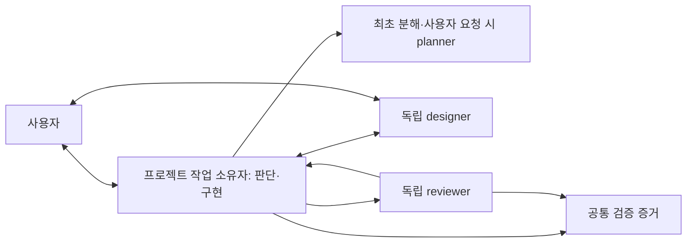

# harness-claude 단순화 후보 조사

조사일: 2026-09-21 · 기준: `74f1207d37881aa4eddfa56e97d534bdb39a3930` 위의 **현재 작업 트리**

## 판단

현재 하네스에는 줄일 수 있는 복잡성이 상당히 있다. 우선순위는 **서로 다른 곳에서 같은 정책과 상태를 판단하는 구조를 통합하는 것**, 그다음은 **필요할 때만 역할과 지시문을 불러오는 것**이다. lead와 developer 통합은 잠재 효과가 큰 실험 후보지만, 첫 정리 작업으로 전면 적용할 근거는 부족하다.

단순화의 성공 기준은 파일 수나 에이전트 수 자체가 아니다. 같은 요구를 끝내는 데 필요한 사용자 개입, 역할 간 인계, 정책 수정 지점, 서로 맞춰야 하는 상태가 줄어야 한다. 독립 검증, 세션 복구, 프로젝트 경계, 데이터 보존은 유지해야 한다.

줄일 대상은 이미 결정된 범위를 다시 허가·전달하는 행동이다. 새로운 취향 선택, 범위 변경, 실제 사용 결과 확인은 유지한다.

이번 조사로 앞선 평가를 두 가지 보정한다.

- **CEO를 없애는 것이 가장 큰 개선은 아니다.** CTO 완료·진행 보고의 CEO 중계와 CEO 자동 wake는 이미 폐지됐다. 남아 있는 주요 인계는 lead↔developer다.
- **상주하는 에이전트가 곧 계속 토큰을 소비한다는 뜻은 아니다.** 현재 탭 없는 세 프로세스가 생존하는 것은 확인했지만, sleeping 상태였다. 토큰 낭비의 크기는 측정하지 않았다.

### 조사 범위와 증거 수준

기존 소스와 지시문을 수정하지 않고 역할·프로세스·훅·CLI·daemon·dashboard·테스트·도입 배경을 교차 확인했다. 로컬 메시지 큐와 로그는 메타데이터만 집계했으며 실제 세션에 입력하거나 세션을 시작·종료하지 않았다. 제품 코드 변경은 없고 조사 문서와 증거 파일만 추가했다.

AGENTS.md의 경계에 따라 런타임 `RULES.md` 본문을 의미 감사 대상으로 삼지 않았다. 해당 정책은 authority map, 역할 문서, enforcer와 설치 경로에서 확인했다. 따라서 이 보고서는 모든 운영 하드룰의 원문 감사나 정책 변경 승인이 아니다.

근거는 다음처럼 구분한다.

| 구분 | 의미 |
|---|---|
| 소스 확인 | 현재 파일의 분기·호출·참조로 확인 |
| 격리 재현 | 임시 디렉터리의 fixture로 현재 함수 동작 확인 |
| 운영 관측 | 남아 있는 로컬 기록 또는 읽기 전용 프로세스 관측 |
| 제안/가설 | 아직 구현하거나 비교 실험하지 않은 변경 |

조사 시작 때 이미 tracked 파일 24개가 수정돼 있었고 `docs/research/`에도 기존 자료가 있었다. 이를 그대로 보존했다. 상세 파일 크기·해시·관측값·재현 결과는 [증거 JSON](harness-simplification-evidence-2026-09-21.json)에 있다. 기존 Astra 전환 보고서는 참고 자료로만 활용했고 현재 소스와 다시 대조했다.

## 1. 복잡성의 크기와 실제 사용 흔적

### 1.1 단일 파일의 책임이 넓다

| 파일 | 현재 줄 수 | 들어 있는 서로 다른 책임 |
|---|---:|---|
| `run.sh` | 2,391 | 역할 설정 생성, 세션 생성·복구·종료, 포트, 설치, doctor, dashboard |
| `harness/cli.py` | 1,284 | 메시지, 역할 발견, 상태, 포트, 공유 DB 관리 |
| `harness/daemon.py` | 795 | 알림, 생존·부분 유실 감지, CEO 사망 기록, probe watcher |
| `dashboard/backend/main.py` | 1,972 | 상태 계산, 인증, 수명주기, inbox, Git, 개발 서버, Docker |
| `dashboard/frontend/src/App.jsx` | 2,436 | 그래프, 대화, 제어, Git, 모달, 레이아웃 |
| `tests/smoke.sh` | 3,738 | 실제 동작 fixture와 지시문·배선 문자열 검사 |

큰 파일이라는 사실만으로 분할을 권하지 않는다. **동일 판정이 복제돼 실제 불일치가 생기는 부분**을 먼저 추출해야 한다. 모든 함수를 파일별로 옮기기만 하면 복잡성은 그대로다.

### 1.2 상시 컨텍스트와 선택적 스킬은 다르게 봐야 한다

| 항목 | 크기/형태 | 해석 |
|---|---|---|
| 공통 RULES | 51,574 bytes, 파일 메타데이터 | Claude 역할에 공통 주입되는 텍스트 |
| CTO role | 9,823 bytes / 149줄 | 정체성과 절차가 혼재 |
| PROCESS | 31,065 bytes / 364줄 | CTO SessionStart에 추가 |
| agent-team-protocol | 14,060 bytes / 275줄 | 프로젝트 `.claude/rules`로 설치 |
| designer role | 20,705 bytes / 297줄 | design-max 설명 약 195줄 포함 |
| 하네스 스킬 6개 | 필요할 때 로드하는 방식 | 설치돼 있다는 이유만으로 모두 매 턴 비용을 낸다고 볼 수 없음 |

CTO SessionStart 입력의 RULES+role+PROCESS 원문 크기 합은 92,462 bytes다. 추가 배너·시작 지시·프로젝트 기억과 별도 자동 로드되는 protocol은 이 합에 포함하지 않았다. **바이트 수는 토큰 사용량이나 추론 비용의 측정치가 아니다.**

`session_start.py`는 PROCESS의 `INJECT-END` 마커 앞만 주입할 수 있지만 현재 PROCESS에는 그 마커가 없다. designer의 design-max 상세도 모드와 무관하게 같은 role 파일에 들어 있다. 이는 기능을 유지하면서 입력을 좁힐 구체적인 위치다. [주입 코드](../../hooks/session_start.py#L101), [designer 상세](../../plugins/designer-cto/role.md#L61)

### 1.3 보존된 기록은 인계 비중을 보여주지만 ROI를 증명하지 않는다

- CEO 제외 빌드 디렉터리 17개: module 10개, project 7개. `tasks.md` 17개, module `USAGE.md` 9개, design-max 마커 1개.
- 메시지 큐 잔존 행 357개, 미읽음 0개. 보존된 메시지 시각 범위는 **2026-07-29~08-28**이다.
- lead↔developer가 287개, 약 **80.4%**다. 이 수치가 불필요한 메시지 비율이나 전체 누적 이용률이라는 뜻은 아니다.
- 생성→읽음 지연의 중앙값은 10초, p90은 240초였다. **읽음은 승인·실행·완료가 아니며**, 과거 설정·사람의 부재·삭제된 기록의 영향을 분리할 수 없다.
- 팀 훅 로그는 8,857행, 마지막 기록은 09-10이다. 테스트성 기록과 중복 이벤트가 섞일 수 있어 block 비율을 오류율로 계산하지 않았다.
- 09-01 이후 보존 로그에서 `TaskCreated`/`TaskCompleted`는 0건이다. 현재 모든 프로젝트가 영구적으로 native task store를 안 쓴다는 증거는 아니다.
- 모든 17개 빌드에 자동 memory 파일이 있다. 따라서 메모리 기능 전체를 단순히 휴면이라고 판단해서는 안 된다.

실행 모델별 비용, 승인에 쓴 사람의 시간, 사용자 개입 횟수, 재작업률을 연결하는 계측은 확인하지 못했다. 절감률·몇 배 빨라진다는 수치는 제시하지 않는다.

## 2. 먼저 바로잡아야 하는 정책 중복

다음은 단순히 문장이 길다는 문제가 아니다. 서로 다른 지시문을 읽은 에이전트가 다른 행동을 할 수 있다.

| 주제 | 현재 함께 존재하는 설명 | 의미 |
|---|---|---|
| 부팅 포트 승인 | CEO role은 CTO의 포트 confirm을 CEO가 회신해야 한다고 설명. CTO role은 08-20부터 해당 왕복을 폐지하고 self-check한다고 설명 | 없앤 승인 절차가 복제본에서 되살아날 수 있음 |
| 게이트1 | `/decompose`는 segment 지정 자체를 게이트1이라 부름. PROCESS는 phase1 완료 뒤 환경 확인을 게이트1이라 부름 | 분해 승인과 환경 승인이 혼동됨 |
| 팀 구성 | protocol은 항상 정확히 planner+reviewer 2명. spawn skill은 기존 tasks가 있으면 reviewer만 | resume/기존 빌드의 기대 구성 불일치 |
| planner 재사용 | planner 본문은 현실이 달라지면 CTO가 깨운다고 서술. frontmatter와 CTO role은 최초 분해 또는 사용자 명시 허용만 | 이미 강화한 one-shot 정책의 반대 신호 |
| 검증 키 | reviewer 지시문은 `<team>/task-<id>.verified`, `<proj>.invoked`를 설명. 현재 소비자는 project 키와 `<proj>.reviewer.invoked` 중심 | 정본과 호환 경로가 혼동됨. team sentinel은 현재 폴백으로 인정되므로 즉시 실패한다고 볼 수 없음 |
| 보류 목록 | LATER에는 4 teammate, 제거된 `orca claude-teams`, 인박스 격리 훅 미구현, GET 인증 미적용 등의 과거 설명이 남음 | 구현된 기능을 다시 만들거나 폐기된 구조를 복원할 위험 |

근거: [CEO 포트](../../plugins/ceo/role.md#L135), [CTO self-check](../../plugins/cto/role.md#L84), [decompose 게이트](../../plugins/cto/commands/decompose.md#L57), [PROCESS timeline](../../plugins/_shared/PROCESS.md#L29), [protocol 구성](../../plugins/cto/rules/agent-team-protocol.md#L21), [spawn 조건](../../plugins/cto/skills/harness-team-spawn/SKILL.md#L8), [planner 본문](../../plugins/cto/agents/planner.md#L21), [reviewer 증거](../../plugins/cto/agents/reviewer.md#L152), [실제 소비](../../hooks/team/team_hook_common.py#L203), [LATER](../LATER.md#L7).

새로운 정책 엔진보다 이 중복부터 제거하는 편이 변경 범위와 위험이 작다. 과거 사고는 이력 문서에 보존하고, 현재 실행 지시에는 현행 계약과 근거 링크를 남긴다. 다만 위 충돌의 최종 정본 확정은 해당 authority와 최신 사용자 결정을 대조해야 하며, 이 보고서가 RULES 원문을 대신하지 않는다.

## 3. 후보 우선순위

`정리`는 정책 목적을 유지하는 변경, `통합`은 내부 구현/상태 경로 변경, `정책`은 사용자가 경험하는 승인·역할 계약 변경이다. 효과와 위험은 비교 실측 점수가 아닌 조사에 근거한 상대 판단이다.

| ID | 후보 | 주된 효과 | 위험 | 성격 | 순서 |
|---|---|---|---|---|---|
| S1 | 정책 사본·stale 지시 정리 | 모순과 변경 지점 감소 | 낮음~중간 | 정리 | 먼저 |
| S2 | 역할·단계별 컨텍스트 로드 | 무관한 지시와 중복 읽기 감소 | 중간 | 정리 | 먼저 |
| S3 | 휴면 UI·함수 정리 | 작지만 확실한 유지보수 범위 감소 | 낮음 | 정리 | 먼저 |
| S4 | 진행·완료 증거 경로 통합 | 서로 다른 완료 판정 제거 | 높음 | 통합 | 설계 후 우선 |
| S5 | 런타임 상태 판정 공통화 | 화면/daemon/CLI 상태 모순 감소 | 중간 | 통합 | 우선 |
| S6 | planner/reviewer를 필요 시 spawn | 시작·재시작 절차 축소 | 중간 | 정책 | 작은 실험 |
| S7 | designer 생존을 필요한 작업에서만 요구 | 비디자인 작업의 기동·복구 범위 감소 | 중간~높음 | 정책 | S5 이후 |
| S8 | 기존 빌드 수정 흐름 명문화 | 재분해·재승인 의식 감소 | 중간 | 정리+정책 | 우선 |
| S9 | lead+developer 단일 작업 소유자 | 가장 큰 인계 경로 제거 | 높음 | 정책+통합 | 제한 pilot |
| S10 | pair 유지 시 승인 범위 재사용 | 동일 범위 재승인 감소 | 높음 | 정책+통합 | S9의 대안 |
| S11 | 계획 검사·테스트를 의미 기준으로 통합 | 표현/도구별 판정 차이 감소 | 중간 | 통합 | S4와 함께 |
| S12 | 리뷰 실행기의 공통 기계 로직 추출 | 두 플러그인 수정 동기화 부담 감소 | 낮음~중간 | 통합 | 후속 |
| S13 | 메모리 수집·정리 경로 축소 | 실제 작성자와 기억의 단절 완화 | 중간 | 정리+통합 | 후속 |
| S14 | design-max 전달·문서 중복 축소 | 디자인 선택은 보존, 전달만 감소 | 중간 | 정리+정책 | 사용 시 검증 |
| S15 | unknown·질문 relay·계획 승인 기준 통합 | 판단 절차와 예외 사본 감소 | 중간 | 정리+정책 | 후속 |
| S16 | 리뷰 적용 범위·증거 보고 간소화 | 무관한 검사와 출력 중계 감소 | 중간 | 정책 | S4 이후 실험 |
| S17 | 콕핏 teammate viewer를 선택적으로 표시 | 보조 pane·고아 viewer 관리 감소 | 중간 | 정책+통합 | 사용 빈도 확인 |
| S18 | dashboard의 Git 기능 범위 재검토 | 큰 부가기능 유지 범위 축소 가능 | 높음 | 제품 범위 | 후순위 |

**S9와 S10을 동시에 큰 프로젝트로 추진하지 않는다.** 인계 자체를 줄일 것인지, 두 세션을 유지한 채 승인 계약을 개선할 것인지 먼저 실험으로 고른다.

## 4. 후보 상세

### S1. 정책은 concern마다 한 번만 정의한다

**현재 문제:** authority map이 있어도 role·PROCESS·protocol·spawn reference·README·LATER가 절차를 반복한다. 2절의 포트·팀 구성·planner·증거 키 모순은 실재한다. map 자체도 현재 daemon에서 제거된 stall을 설명한다.

**작은 변경안:** role에는 정체성·권한·담당 산출물만, PROCESS에는 빌드 순서·사용자 게이트만, task-format에는 문법만, hook 공통부에는 기계 판정만 둔다. 사용자가 자주 보는 짧은 설명은 유지하되 정책 전문 복제는 참조로 바꾼다. 사고 경위의 긴 본문은 별도 이력으로 옮긴다.

**남겨야 할 것:** 명령 실행에 바로 필요한 금지·승인 경계와 예외. 링크만 남겼는데 에이전트가 읽지 않아 필수 규칙이 사라지는 식의 축약은 안 된다.

**영향 파일:** CEO/CTO/planner/reviewer role, PROCESS, agent-team-protocol, spawn skill/reference, decompose, README, authority map, LATER 및 doctor의 검사.

**확인 방법:** concern별 authority 하나, 모든 참조 경로 유효, 신규/기존 빌드의 기대 역할 수 일치, segment 승인과 환경 게이트 명칭 구분. 이 변경은 하드룰을 재설계하지 않고 현행 결정을 일치시키는 범위로 자른다.

### S2. 상시 지시문에서 역할·모드와 무관한 상세를 분리한다

**현재 문제:** CTO는 빌드 전체 PROCESS를 SessionStart에서 받고, 디자이너는 일반 모드에도 design-max 상세를 받는다. 반면 스킬은 이미 필요 시 로드하므로 스킬 파일 수만 줄여서는 큰 변화가 없을 수 있다.

**작은 변경안:** 시작 시 필요한 역할·승인·현재 상태·다음 절차의 짧은 안내는 유지한다. phase2/design-max, module 마감, 재사용/extract 절차 등은 해당 작업에 들어갈 때 정확한 reference를 읽게 한다. 이미 있는 PROCESS 주입 경계 기능과 reference 디렉터리를 우선 활용한다.

단, 최초 분해를 하는 planner는 나중 단계의 검수 기준까지 tasks에 넣어야 하므로 **분해 전에 적용되는 모든 phase 계약을 읽어야 한다.** 단계별 지연 로드가 계획에 필요한 선행 정보를 숨겨서는 안 된다. designer가 같은 디렉터리의 lead 전용 commands/agents를 상속해 역할을 오인했던 기록도 있다. 역할별 도구 노출을 줄일 수 있는지는 별도 런타임 확인 대상이며, 확인 없이 기존 신원 배너부터 지우지 않는다. [역할 오인 배경](../../hooks/session_start.py#L186)

**남겨야 할 것:** 사용자 승인 범위, 인박스의 비신뢰성, production writer 경계, 복구 시 팀 소멸 사실은 항상 접근 가능해야 한다. 공통 RULES를 일괄 잘라내는 제안은 아니다.

**위험:** 압축률만 추구하면 필요한 절차가 발견되지 않는다. 초반에 짧은 진입 규칙이 있어야 하고, fresh/resume/일반 디자인/design-max/모듈 종료 각각에서 필요한 reference를 읽는지 확인해야 한다.

**측정:** 실제 시작 입력 tokens, 같은 사실 재질문, 잘못된 역할 수행, 작업 완료까지의 읽기 호출 수. 현재 바이트 수로 금액 절감을 계산하지 않는다.

### S3. 실제로 호출되지 않는 UI와 작은 함수를 먼저 치운다

**소스 확인:** `App.jsx`의 `Graph()`는 정의 외 사용이 없고 실제 렌더는 `BrainGraph()`다. `GraphBoundary`도 사용되지 않는다. `ForceGraph2D` import와 `react-force-graph-2d` 의존성은 휴면 Graph에 연결돼 있다. backend `_cto_alive`, `_cto_fully_alive`도 정의 외 호출이 없다.

근거: [휴면 Graph](../../dashboard/frontend/src/App.jsx#L205), [GraphBoundary](../../dashboard/frontend/src/App.jsx#L331), [실제 BrainGraph](../../dashboard/frontend/src/App.jsx#L762), [의존성](../../dashboard/frontend/package.json#L13), [backend 함수](../../dashboard/backend/main.py#L693).

**작은 변경안:** 이 닫힌 묶음만 제거하고 lockfile을 정합하게 갱신한다. 새로운 그래프 라이브러리로 교체하거나 dashboard 전체를 다시 쓰지 않는다.

**검증:** 실제 BrainGraph 표시·노드 선택·레이아웃 저장·제어 모달이 유지되는지 확인하고 frontend build를 수행한다. 동적 사용이나 외부 import가 없는지도 변경 직전에 다시 확인한다.

**효과의 한계:** 소스/의존성 유지 범위 감소는 분명하다. 실제 번들 크기·페이지 속도 개선은 tree shaking 결과를 보지 않았으므로 미측정이다. daemon의 운영 미호출 helper도 테스트가 직접 쓰면 의미 보존 후 제거해야 한다.

### S4. `tasks.md`와 native task store의 완료 판정을 하나로 모은다

**현재 문제:** 프로젝트 진행 정본은 `tasks.md`지만 native `TaskCreated`/`TaskCompleted`용 규칙·sentinel·task ID·재배달 marker도 유지된다. teammate는 task-store 도구를 받지 못해 lead가 대행한다. 이 때문에 두 입력 경로, 두 증거 소비 방식, legacy team/project 키를 맞춰야 한다.

아래는 `[review]` 완료 경로의 비교다. 일반 native task는 Run+sentinel이 기본이고 reviewer 호출·regression은 review에 추가된다. 명시 waiver가 있으면 review의 검증 경로 전체를 먼저 면제한다.

| review 완료 경로 | 현재 확인 방식 | 차이 |
|---|---|---|
| TaskCompleted | Run 존재, task sentinel, reviewer 호출, regression, waiver | sentinel 소비, `.lastreview` 갱신, prompt ID 재배달 처리 |
| tasks.md 편집 | review 미완→완료 전이, reviewer 호출, regression, waiver | 편집 전이므로 `.lastreview`를 갱신하지 않음; 같은 호출 재사용 가능 |

근거: [tasks.md 경로의 의도된 한계](../../hooks/team/tasks_md_review_gate.py#L29), [TaskCompleted 소비](../../hooks/team/task_completed_verify_gate.py#L208), [공통 판정](../../hooks/team/team_hook_common.py#L158).

**목표:** 사용자에게 보이는 진행은 `tasks.md`로 유지하되, 완료 승인 조건을 계산하는 코드와 증거 계약을 하나로 만든다. native task store를 계속 지원한다면 정본 상태를 보여주는 호환 어댑터로만 남긴다. Markdown과 DB가 각각 진실을 결정하는 새 이중화를 만들지 않는다.

**증거에 필요한 최소 정보:** 프로젝트·안정적인 작업/segment 식별자, 검증 대상 revision 또는 작업 트리 digest, 실행 명령·exit code, 독립 리뷰 판정과 대상 범위, 필요한 사용자 승인/waiver 범위. 미커밋 작업이 기본이므로 Git HEAD만으로 검증 대상을 식별하면 안 된다.

digest 대상은 검증에 영향을 주는 코드·설정·검증 명세로 명시한다. 완료 체크박스와 증거 기록 자체를 포함하면 완료 처리만으로 자신의 검증이 무효화된다. 반대로 명령/acceptance 변경을 무시해서도 안 된다. 증거 생성자와 사용자 승인 주체를 같은 모델의 파일 작성으로 대체하지 않는다.

**의도적으로 필요한 구분:** `회귀 0`은 `모든 검사 성공`이 아니다. `대상 없음`, `기준선 없음`, `새 명령 실패`, `기존 실패`, `회귀`를 별도 결과로 표현하고 완료 판단에서 명시적으로 처리한다.

**전환 순서:** 공통 verdict 함수와 같은 fixture를 두 경로에 적용 → 실제 사용 경로 관측 → 파일 편집 성공 이후에만 증거 소비/완료 기록 → native 경로가 필요 없다고 확인된 프로젝트부터 의존 제거 → legacy 키의 읽기 폴백 종료. PreToolUse에서 성공 상태를 먼저 확정하지 않는다.

이 원칙이 실행 전의 **원자적 예약**까지 없애라는 뜻은 아니다. 동시 호출이 모두 통과하지 않도록 시도별 식별자로 예약하고, 실제 실행 성공 시 확정하며, 실패·프로세스 소멸 시 회수하는 계약이 필요하다. predicate는 공통으로 만들고 예약/확정/복구는 명시적 부작용으로 분리한다.

**금지할 지름길:** TaskCompleted 훅을 먼저 삭제하거나, `.verified`가 있으니 실제 성공이라고 간주하거나, 모든 상태를 새 DB/워크플로 엔진으로 옮기는 대규모 재작성. 파일 증거도 같은 OS 사용자에게 쓰기 가능하면 보안상 신뢰 경계가 생긴 것은 아니다.

### S5. CLI·dashboard·daemon의 런타임 관측을 공통화한다

**현재 문제:** `dashboard /api/state`와 `_cto_snapshot`이 같은 세 역할의 active/ready를 따로 계산한다. 한쪽만 designer를 반영해 `partial`인데 `ready=True`였던 사고가 코드 주석에 남아 있다. daemon은 별도의 Claude/Codex pair 관측을 사용한다.

근거: [중복 state 계산과 사고](../../dashboard/backend/main.py#L478), [snapshot](../../dashboard/backend/main.py#L678), [daemon pair](../../harness/daemon.py#L227), [Orca 관측](../../harness/orca_runtime.py#L98).

**작은 변경안:** 각 CLI 요청·dashboard 요청·daemon tick 안에서 역할별 terminal 존재·연결 가능 여부·keeper 상태·관측 실패를 단일 snapshot으로 수집하고 공통 함수로 해석한다. 별도 중앙 수집 서비스를 만들 필요는 없다. ready를 판단하는 데 필요한 역할 집합은 명시적으로 받는다. daemon 경보 정책과 화면 표시 정책까지 반드시 같아야 하는 것은 아니다.

**꼭 구분할 상태:** 프로세스 없음, 프로세스는 있으나 UI 연결 없음, 정상 연결, 조회 실패로 판단 불가. 조회 실패를 정지로 해석해 새 프로세스를 만들지 않는다.

**남겨야 할 것:** exact durable title, 프로젝트 경로 검증, 중복 title 거부, keeper, resume, start/stop 후 끝상태 확인, 프로젝트별 락, 시작의 전역 직렬화. 관측 통합이 제어 동시성 보호를 삭제하는 이유가 되지 않는다.

**검증:** 각 역할 조합, 중복 title, stale socket, runtime 조회 실패, 부분 기동, 탭 유실, stop 뒤 재개에서 같은 관측이 모순된 화면을 만들지 않는지 확인한다.

**같이 줄일 수 있는 작은 중복 두 가지:**

- `run.sh`의 embedded Python과 `orca_runtime.py`의 title/handle 해석을 하나의 함수로 모은다. 동일한 `leafId == tabId` 오판 수정이 양쪽에 복제돼 있다. 역할 표시는 작은 상수표로 공유하되 pair-only 통신 권한까지 느슨하게 일반화하지 않는다. [Bash 쪽](../../run.sh#L66), [Python 쪽](../../harness/orca_runtime.py#L169)
- dashboard의 개별 start/stop과 전체 start/stop을 “프로젝트 하나의 요청 동작 실행→캐시 무효화→끝상태 확인” 함수에 위임한다. 현재 같은 흐름을 다시 구현한다. 프로젝트별 락, 전역 시작 직렬화, 비동기 keeper 생성 대기는 보존한다. Python 프로세스 내부 `threading.Lock`을 옮기는 것만으로 CLI와의 프로세스 간 직렬화까지 보장되지 않는다. [개별](../../dashboard/backend/main.py#L723), [전체](../../dashboard/backend/main.py#L1775)

### S6. planner/reviewer는 실제 작업이 있을 때 spawn한다

**현재:** 시작 마커가 있으면 단순 질문 턴에도 fresh는 planner+reviewer, tasks가 있으면 reviewer를 먼저 spawn한다. 이를 위해 startup marker, spawn nudge, 역할당 claim, 일회성 planner dispatch 게이트 등이 협동한다.

**제안:** planner는 최초 `/decompose` 또는 명시된 계획 요청에, reviewer는 첫 리뷰 요청에 생성한다. 같은 역할을 여러 개 만들지 않는 보장은 유지하되, 실제 성공한 roster/session 정보로 재사용 여부를 판단한다. resume 뒤 팀원이 사라졌다는 사실도 유지한다.

roster 조회만으로 중복 spawn을 막을 수는 없다. 조회→생성 사이의 동시 요청을 막는 원자 예약은 유지하고, 실패한 시도가 영구 claim으로 남지 않도록 확정/회수를 분리한다. 처음부터 start/gate/nudge 각각이 다른 훅의 예외를 복제하기보다 공통 함수에서 시작 신호·필수 역할·planner 허용·inbox 격리·로스터를 판정한다.

startup override, start gate, Stop nudge의 필수 roster, claim 초기화, 미존재 수신자 안내도 함께 맞춘다. reviewer 생성만 늦추고 기존 강제 spawn 지시를 남겨두면 서로 반대되는 지시가 다시 생긴다.

**효과:** 인사·조회·기존 빌드의 간단한 대화에 팀 준비 의식을 선행하지 않아도 된다. 불필요한 spawn 시도와 시작 상태 수를 줄일 수 있다. 얼마나 시간이 줄지는 미측정이다.

**중요한 경계:** 이는 08-04의 사용자 지정 upfront-spawn 정책을 바꾸는 후보다. 현재 규칙을 잘못 구현했다고 주장하는 것이 아니다. reviewer의 **생성 시점**을 늦추는 것과 필수 리뷰를 없애는 것은 별개다.

**검증:** 인사에서는 0명, 신규 분해에는 planner 1명, 첫 리뷰에는 reviewer 1명, 이미 살아 있으면 재사용, spawn 실패 후 재시도 가능, resume 뒤 사라진 팀에게 메시지 보내지 않기. [시작 정책](../../plugins/cto/skills/harness-team-spawn/SKILL.md#L28), [실행 전 claim](../../hooks/team/one_teammate_per_role_gate.py#L105)

### S7. designer를 항상 ready에 필요한 세션에서 작업별 선택 세션으로 바꾼다

**현재:** add-cto는 lead/developer/designer 세 세션을 준비하고 dashboard는 셋 모두 생존해야 ready로 본다. backend 작업만 할 때도 designer가 없으면 partial이다.

**제안:** designer의 독립 탭과 사용자 직접 대화는 유지한다. 디자인 시작 또는 사용자의 직접 요청 때 세션을 준비하고, 비디자인 작업에서는 designer 부재를 장애로 보지 않는다. 기존 명령 표면을 활용하고 불필요한 새 명령은 만들지 않는다.

**영향 범위:** add/attach/fresh/stop/delete, same-name route, daemon wake/route와 작업별 기대 역할 정책, dashboard ready/복구 버튼, frontend 문구, doctor, smoke. 현재 daemon의 유실 경보 집합은 lead+Codex이며 designer를 이미 제외한다. dashboard의 `and designer` 한 줄만 제거해서는 안 된다.

**도입 배경을 보존:** 독립 designer는 사용자가 직접 미세조정하기 어렵다는 문제를 해결하려고 분리됐다. 이를 다시 lead의 간접 대화로 되돌리는 것은 추천하지 않는다. [당시 사용자 요구](../superpowers/specs/2026-07-29-designer-cto-split-design.md#L5)

**확인:** 디자인 세션 없이 backend 작업 준비 완료, 디자인 요청 시 정확한 기존 세션 복원, 디자인 진행 중 세션 유실은 감지, stop/delete에서 이미 만들어진 optional 세션도 정리, 기존 3세션 빌드와 호환.

### S8. 기존 빌드의 작은 수정에 새 빌드 의식을 적용하지 않는다

**현재:** 최초 분해 공식은 phase1 환경→phase2 UI→phase3+ 개발이다. 반면 완료 빌드의 새 작업은 planner를 자동 재호출하지 말고 lead가 직접 판단해 dev로 보내라는 예외가 이미 존재한다.

**제안:** 새로운 fast-mode 플래그를 만들기보다, 기존 예외를 하나의 명확한 진입 규칙으로 정리한다. 변경이 기존 승인 범위의 유지보수인지, 새로운 사용자 요구인지, 디자인 방향 변경인지 판정하고 필요한 단계만 밟는다. 작은 설정/문구 수정에 환경·디자인 승인을 다시 요구하지 않는다.

**남겨야 할 것:** 범위 확장, 새로운 디자인 방향, DB 파괴적 변경, 배포 등의 실제 결정은 별도 사용자 권한이다. 기존 accepted behavior와 관련 회귀 검증도 유지한다.

**주의:** 현재 필수 리뷰 정책을 자동으로 면제하는 제안이 아니다. 리뷰를 생략하거나 배치할 기준은 독립적인 정책 변경이다. 처음에는 리뷰 범위와 보고량을 변경 크기에 맞추는 것만으로 실험한다.

**검증 작업군:** 문구/설정 수정, 국소 버그, API 계약 변경, migration, 새 화면, 완료 빌드의 새 요구. 각 경우에 불필요한 재분해와 필요한 승인 누락을 함께 센다. [기존 예외](../../plugins/cto/role.md#L72)

### S9. 한 프로젝트에서 lead와 developer를 하나의 작업 소유자로 합치는 pilot

**구조적 근거:** 현재 lead는 구현·테스트 실행을 금지받고, 실제 구현자는 별도 Codex다. lead에서 승인한 범위를 전달해도 사용자가 Codex에서 다시 명시 승인해야 한다. 결과 보고도 역방향 inbox를 거친다. 보존된 큐의 80.4%가 이 페어 통신이다.

**제안 구조:** 한 세션이 승인된 프로젝트 범위의 판단·구현·검증 실행·사용자 소통을 이어서 맡는다. 최초 분해는 현행 적용 범위대로 planner에, 디자인은 독립 designer에, 결과 평가는 독립 reviewer에 요청한다. 작업 크기에 따른 planner 생략은 초기 pilot에 섞지 않는다. CEO는 상위 기획·모듈 재사용·하네스 운영 창구로 유지할 수 있다.

이 그림은 제안이며 현재 구현이 아니다. 하나의 모델이 자신의 작업을 최종 승인하는 구조를 뜻하지 않는다.

**없앨 수 있는 것:** 프로젝트 내부 lead↔developer 발주·완료·수정 전달, 그 경로의 동일 범위 재승인, 역할 오인 일부. SQLite 전체를 제거하거나 CEO·designer·독립 리뷰 통신까지 없앨 필요는 없다.

**잃을 수 있는 것:** lead가 구현 세부에서 떨어져 요구/범위에 집중하던 장점, 두 모델의 판단 차이, 사용자가 각 탭에서 개입하는 경험. 현재 Codex의 production-only 권한도 바뀐다.

**영향:** role, production writer 제약, planner 판정 수신자, hook 어댑터, daemon route, 상태 화면, resume 모델까지 걸린다. 프롬프트 몇 줄 변경으로 끝나지 않는다. 모델 교체와 역할 통합을 동시에 실험하면 어느 변화가 효과를 냈는지 알 수 없다.

**pilot 조건:** 한 빌드만 opt-in, 같은 도구·모델 설정·회귀 기준으로 현행 정리판과 비교, 독립 리뷰와 게이트1/2/3의 사용자 확인 및 다음 segment 지정 계약 유지, 세션/산출물 기록 보존, 문제가 생기면 기존 역할 경로로 돌아갈 수 있어야 한다. 역할 통합 실험에 최종 실사용 승인 생략까지 섞지 않는다.

### S10. pair를 유지한다면 이미 승인한 범위를 재사용한다

**현재:** 메시지는 비신뢰 데이터이며 사용자 승인이 아니다. 같은 턴 도구 격리와 다음 사용자 턴 승인이 공격성 지시의 반사적 실행을 억제한다. 단순히 이 훅을 끄면 편의뿐 아니라 권한 계약이 달라진다. [현재 developer 승인](../../plugins/codex-cto/role.md#L23), [inbox 격리](../../hooks/inbox_isolation_guard.py#L1)

**대안:** 사용자가 승인한 프로젝트·범위·허용 행동을 실행 경로에서 식별하고, 해당 범위 안의 진행/검증 결과만 이어서 처리한다. 새 범위·새 권한·다른 프로젝트·오래된 지시·재전달을 구분해야 한다. 메시지 본문의 `승인됨`은 권한 근거가 될 수 없다.

**단순화와의 긴장:** 이를 위해 서명·권한 DB·스케줄러·상태머신을 새로 크게 만들면 절차 몇 개를 줄이려다 시스템을 더 복잡하게 만든다. S9로 인계 자체를 줄이는 편이 더 작을 수도 있다.

**최소 실험:** 사용자에게 동일 범위를 재설명시키는 텍스트를 줄이고, 승인 범위와 다음 실행 대상을 정확히 보여주는 UX부터 비교한다. 자동 실행은 별도 정책 선택 후 검증한다.

**필수 실패 케이스:** inbox에 권한 확장 문구, 동일 프로젝트의 과거 범위, 승인 후 scope 수정, 취소 후 재전송, developer 재시작, 외부 발신 role 위장. 같은 OS 사용자에게 쓰기 가능한 승인 파일은 독립적인 보안 경계가 아니라는 한계를 명시한다.

### S11. 계획 검사와 테스트를 문구 핀에서 공통 의미 계약으로 옮긴다

**현재:** `phase2_viewable_gate`는 Write에만 반응하고 4개 서버 시작 토큰을 찾는다. mock/local-state의 실제 동작은 검사하지 않는다. README/doctor/smoke의 일부 검사는 문자열 존재나 복제된 정규식 일치에 의존한다.

**제안:** `tasks.md`의 phase/ckpt/role/Run/feature 참조를 읽는 공통 파서를 사용한다. 분해 중간 저장을 막기보다 **분해 완료/실제 실행 준비** 시점에 필요한 계약을 검사한다. Write/Edit/다중 편집/적용 결과의 차이는 입력 어댑터가 처리하고 의미 판정은 공통으로 둔다.

이 시점은 아직 구현된 강제 이벤트가 아니다. 기존 명령이나 dispatch 중 어디서 최종 파일을 읽어 검사할지 먼저 정해야 한다. 현재 planner 게이트는 tasks.md의 존재만으로 최초 분해 완료를 판단하므로, 부분 저장 허용과 완료 시점 변경을 따로 적용하면 충돌한다. 또한 Write/Edit 어댑터 공통화만으로 Bash/Codex 편집까지 관측하지는 못한다. 편집 도구와 무관하게 다음 공식 실행 전이에서 최종 파일을 검사하거나, 적용하지 못하는 경로를 명시해야 한다. [현재 존재 판정](../../hooks/team/planner_dispatch_gate.py#L37), [Codex 배선](../../harness/codex_hooks.py#L88)

**유지할 검사:** 명령어 surface와 폐기된 위험 경로를 금지하는 문자열 검사도 가치가 있다. 모든 정적 검사를 없애자는 뜻은 아니다. 문구를 바꾸면 실패하지만 동작을 깨뜨려도 통과하는 검사를 결과 중심으로 바꾼다.

**안전한 범위:** 새 workflow DSL을 만들지 않는다. 기존 Markdown 형식·안정적인 ckpt ID·From 포인터·supplied 태그는 재사용 계약이므로 유지한다. API-only/기존 UI 수정 같은 별도 phase 정책은 사용자가 결정하기 전엔 검사기 예외로 슬쩍 추가하지 않는다.

**검증:** 동등한 표현은 같은 판단, feature 누락은 실패, 부분 저장은 허용, phase2 서버 미룸은 검출, 실제 UI 검수는 별도 실행 증거로 확인. [현재 phase2 검사 범위](../../hooks/team/phase2_viewable_gate.py#L11), [토큰](../../hooks/team/phase2_viewable_gate.py#L35), [Write 한정](../../hooks/team/phase2_viewable_gate.py#L80)

### S12. 독립 리뷰 두 플러그인의 실행 기계 부분만 공유한다

**현재:** codex-review와 codex-protocol-review는 대상·prompt·보고 범주는 다르지만 프로세스 실행·보고서 읽기·launch ID·문자열 요약 등의 구조가 겹친다. AST 비교에서도 8개 함수가 동일했다.

**확인된 동일 함수:** `path_is_inside`, `read_report`, `launch_id_line`, `embed_launch_id`, `count_terms`, `format_counts`, `extract_overall_risk`, `tail_text`. runner는 각각 519/239줄, report_writer는 202/172줄이다.

**제안:** 작은 공통 helper에 보고서 envelope와 launch/consume의 기계 처리를 모은다. target별 context builder와 prompt는 그대로 둔다. 이 차이를 거대한 옵션 객체로 일반화하지 않는다.

**보존:** `/codex-review`, `/codex-protocol-review` 명령, 사용자 명시 실행, shell=False 인자 경계, pending report와 launch ID의 연결, 모듈의 host 책임 구분, 실패 리포트.

**검증:** 두 target의 정상·실패·중복 consume·위조 launch ID·잘못된 프로젝트 경로·악의적인 인자를 같은 공통 fixture와 각 target fixture로 확인한다. 이것은 독립 리뷰를 없애거나 두 리뷰 목적을 섞는 변경이 아니다.

### S13. 메모리는 표면을 무조건 합치기보다 생산자와 수집 경로를 맞춘다

**현재 장점:** 자동 기억, feature별 decisions/learnings, 장기 정책, 사용자 선호를 구분한다. 잘못된 관측이 모든 미래 세션의 규칙으로 자동 승격되는 일을 막는다.

**실제 틈:** `project_memory.py`는 `cto:` 역할만 수집한다. production 구현·테스트 주체는 `codex-cto:`인데 Codex 훅 설치에는 memory PostToolUse가 없다. 따라서 현재 자동 수집기가 실제 developer의 모든 빌드/테스트 실행을 직접 기록한다고 볼 수 없다. 파일이 존재하는 것과 최신 사실이 정확히 갱신되는 것은 다르다. [수집 역할](../../hooks/project_memory.py#L312), [Codex 설치 훅](../../harness/codex_hooks.py#L88)

**작은 변경안:** S4의 검증 실행 결과에서 재사용 가능한 명령·환경 사실을 뽑아 자동 기억과 완료증거를 연결한다. 모든 tool output을 새로 저장할 필요는 없다. decisions와 learnings를 하나의 project-notes 문서의 구분된 절로 합치는 것은 후보지만, 기존 링크/동시쓰기/이력 호환부터 확인한다.

**스킬 정리:** `remember`의 라우팅 설명을 짧게 하고 `self-improve`는 명시 회고 시 쓰는 보조 참조로 두는 안을 비교한다. 이미 필요 시 로드되는 기능이고 호출 흔적이 적으므로 최우선 성능 개선 대상으로 과장하지 않는다.

**남겨야 할 것:** 확실성 표시, 충돌 보존, 정책/개인 선호의 임의 승격 금지, 비밀값 제거, FIFO 제한과 atomic write. 기억을 한 파일에 무분별하게 합치거나 자동으로 RULES에 반영하는 방향은 제외한다.

### S14. design-max는 선택과 전달을 구분해 단순화한다

**현재:** 구조 refs 선택, wireframe 확인, dark/light 선택, 토큰 확인, 사용자 Claude Design 작업, handoff 배치, designer 정합 확인, lead에 경로 통보, developer 발주가 이어진다. design-max 상세는 역할·decompose·PROCESS·설계 스펙에 흩어져 있다.

**줄일 부분:** 산출물 목록과 계약을 한 곳에서 정의하고, 최종 승인 bundle의 경로·버전·미해결 사항을 한 번 기록한다. lead와 developer가 같은 경로를 다시 요약·복사하지 않게 한다. design-max 상세는 해당 모드에 진입할 때만 로드한다.

**유지할 부분:** 구조 승인과 시각적 취향 결정은 서로 다른 사용자 결정일 수 있다. 무조건 한 번의 승인으로 합치지 않는다. 디자인 산출물은 구현 전의 검토 대상이고 게이트2는 실제 production UI 검수이므로 단순한 중복이 아니다.

**주의:** 독립 designer와 직접 대화, design-max에서 사용자가 Claude Design을 조작하는 방식은 명시된 사용자 선택이다. 자동 MCP export/push가 현재 실제 도구에서 가능한지 이번에는 실호출하지 않았다. 과거 문서에 있다는 이유로 자동화 가능하다고 전제하지 않는다.

**검증:** 승인된 디자인과 구현 계약의 revision 일치, 없는 optional assets를 실패로 보지 않기, stale handoff 거부, backend 없이 핵심 UI 확인, lead에 전달하는 사용자 메시지 수와 중복 설명량 비교. [design-max 계약](../../plugins/cto/commands/decompose.md#L21), [역할 상세](../../plugins/designer-cto/role.md#L61)

### S15. unknown·질문 relay·계획 승인을 하나의 판단표로 정리한다

**규모:** unknowns-check 묶음은 Markdown 7개/1,008줄, relay-qa는 5개/552줄이다. 여기에 spawn의 93줄 plan-approval reference와 remember의 결정 기록 규칙이 연결된다. 필요 시 로드되는 문서이므로 이 합이 매 요청 입력량이라는 뜻은 아니다.

**중복되는 판단:** 이미 사용자가 답했는가, 소스에서 알 수 있는가, 가역적인 기본값인가, 구조적인 선택인가, 사용자에게 물어야 하는가, 어디 기록하는가. 이 판단이 여러 파일에서 조금씩 다르게 표현된다. relay의 best guess 허용과 unknown downgrade 금지, DB 선택의 금지와 허용 예시가 엇갈리는 부분도 있다.

**제안:** 결정표 하나에 `관측 가능한 사실→직접 확인`, `이미 결정됨→기존 결정 사용`, `낮은 영향·되돌릴 수 있음→기본값과 근거 표시`, `의도·구조·권한 선택→사용자 질문`을 둔다. 역할별 차이는 질문을 전달하는 채널만 설명한다. 독립 디자이너를 여전히 teammate로 취급하는 relay 설명도 정리한다.

**95% 규칙:** 현재 confidence reference는 95%를 언어적 질문·체크리스트로 설명하고 경험적 숫자라고 부르지만, 이를 확률로 보정한 데이터는 제시하지 않는다. 불확실성을 수치처럼 포장하는 문장보다 관측 가능한 인수기준·미해결 의존성·명시된 가정을 남기는 편이 검증 가능하다. 숫자 기준을 제거하는 것 자체는 정책 변경으로 취급한다. [현재 정의](../../plugins/cto/skills/harness-unknowns-check/references/confidence-rule.md#L3)

**보존:** 사용자의 무응답은 구조적 선택이나 권한 확대의 승인이 아니다. 불확실성을 숨기지 않기, scope 임의 확장 금지, 질문 전 기존 파일 읽기, 서로 의존하지 않는 질문은 묶어서 전달하기. 역할 통합과 무관하게 유효한 축약이다.

**검증:** 같은 unknown 사례를 planner/lead/designer가 판단해도 질문 필요 여부가 같고, 채널만 달라지는지 확인한다. `plan-approval-default`가 실제 매 task마다 실행된다는 근거는 부족하므로 그 문서를 지워 모든 승인 턴이 줄어든다고 계산하지 않는다.

### S16. 리뷰의 독립성은 유지하고 적용 범위와 출력 중계를 줄인다

**현재:** reviewer는 code-review와 qa-only를 Fixed Skills로 안내받고 API/DB/외부 바인딩 확인을 mandatory duties로 받는다. 또 완료된 Run baseline/check와 전체 출력 전달이 요구된다. lead는 그 증거를 다시 사용자에게 인용한다. [고정 스킬/검사](../../plugins/cto/agents/reviewer.md#L90), [출력 전문](../../plugins/cto/agents/reviewer.md#L342)

**제안:** 실제 변경이 건드리는 계약에 따라 API·DB·UI·배포/네트워크 검사를 선택하고 적용하지 않는 이유를 남긴다. GUI 없는 코드 변경에 UI 도구 사용 자체가 완료 조건이 되지 않도록 한다. 현재 의미 있는 회귀 기준과 별도 인수 검증은 유지한다. 모든 작은 수정에 똑같은 체크리스트를 복제하는 것과 실제 영향을 확인하는 것은 다르다.

**출력:** command·exit·대상 revision·핵심 출력은 대화에서 확인 가능하게 하고, 긴 성공 로그는 한 산출물로 보존한다. 실패 증거·재현 명령·검증 제외 범위는 생략하지 않는다. `/goal` 평가자가 대화만 읽는 현재 계약이 있으므로 **파일 링크만 주고 대화 증거를 없애는 방식은 금지**다. 필요한 증거 요약의 계약을 먼저 정한다.

**리뷰 빈도는 별도 실험:** segment별 리뷰를 더 큰 단위로 묶는 것은 보호 수준 변경이다. 이 후보를 구현한다는 이유로 자동 면제하지 않는다. 현재 필수 스킬 호출과 실제 독립 검증 성공이 다르다는 점도 S4에서 먼저 정리한다.

**측정:** 실제 추가 발견 결함, 잘못된 수정 요구, 검증 시간, 메시지/로그 중복량. code-review 실행 수가 줄었다는 사실만으로 개선이라고 판단하지 않는다.

### S17. 콕핏의 teammate viewer는 필요할 때 표시한다

**현재:** rail 생성은 skill feed와 planner/reviewer viewer를 추가로 띄운다. viewer의 고아 수거, skill feed 프로세스에 의존한 멱등 판정, 구형/현행 transcript 탐색까지 관리한다. 각 viewer는 주기적으로 파일을 다시 읽는다. [생성·수거](../../run.sh#L227), [주기 조회](../../harness/teammate_tail.py#L249)

**제안:** lead+활동 요약을 기본으로 두고 teammate 상세는 사용자가 선택할 때 하나의 읽기 화면에서 표시하거나 요청 시 viewer를 연다. 에이전트 생명주기와 로그 표시 프로세스의 생명주기를 분리한다.

**효과/위험:** 보조 pane과 고아 viewer 관리가 줄 수 있다. 다만 사용자가 팀원을 관찰하는 능력을 잃으면 운영성이 나빠진다. 현재 실제 관찰 빈도와 UI 선호는 미측정이다. 기존 native 선택 UI로 충분한지도 실화면 확인 없이 단정하지 않는다.

**검증:** 표시하지 않아도 팀은 정상 실행, 선택 시 최신/이전 세션 구분, 탭 닫기/복원에 viewer 누적 없음, 예전 transcript 조회 계약 유지. 구형 parser 제거는 과거 대화 열람 지원 여부를 결정한 뒤 한다. read-only viewer를 지운다고 팀 자체가 없어지는 구조여서는 안 된다.

### S18. dashboard가 Git 클라이언트까지 담당해야 하는지 검토한다

**현재:** backend의 Git 관련 영역은 대략 876줄, frontend 관련 영역은 약 490줄이다. status·diff·ignore·stage·unstage·remote·commit·push까지 포함하며 실제 UI에서 사용된다. **휴면 코드가 아니다.** [backend 시작](../../dashboard/backend/main.py#L878), [Git UI](../../dashboard/frontend/src/App.jsx#L1291)

**선택지:** 운영 상태와 Git 조회만 유지하고 변경 동작은 기존 개발 도구로 보내기, 또는 현재 기능을 유지하되 Git 서비스/화면 경계로 분리하기. 전자는 제품 범위 축소, 후자는 유지보수 구조 개선이다. 두 효과를 혼동하지 않는다.

**권고:** 후순위. 사용자가 dashboard에서 Git 작업을 얼마나 하는지 확인하지 않았고, 기능을 없애면 다른 도구로 옮겨 다녀야 할 수 있다. 줄 수가 크다는 이유만으로 제거할 수 없다. 이 저장소의 목적을 '프로젝트 운영 콘솔'로 좁히려는 선택이 있을 때 검토한다.

**보존/검증:** 미커밋 상태·실제 업로드 대상 조회, 실수 방지, 명시적 commit/push, 에러 전달. 기능을 분리하는 경우에도 현재 토큰 인증·경로 검증·끝상태 검증을 유지한다.

## 5. 격리 재현으로 확인한 다섯 가지 경계

아래는 운영 장애가 발생했다고 주장하는 목록이 아니다. 현재 함수의 판정 경계를 임시 fixture로 재현한 결과다. 같은 fixture를 조사자와 메인에서 각각 실행해 결과가 일치했다. 실제 사용자 HOME/CODEX_HOME은 변경하지 않았고 모듈의 상태 경로만 임시 디렉터리로 바꿨다.

| 사례 | 입력/절차 | 관측 결과 | 단순화 설계에 주는 조건 |
|---|---|---|---|
| 검증 대상 0개 | phase1 완료 `Run: true`만 두고 baseline/check | 둘 다 exit 0, 증거 파일 없음, 완료 predicate는 기준선 없음 | no-op 성공과 증거 없음의 의미를 맞춰야 함 |
| 명령 변경 | 같은 ckpt의 `Run: true` 기준선 후 `Run: false`로 수정 | 실행 exit 1, check exit 0, regressions 0, not_in_baseline 1 | 명령 문자열 변경을 새 검사로 보는 현재 정의상 회귀 아님. 이를 전체 성공으로 해석하면 안 됨 |
| 리뷰 호출 재사용 | `.reviewer.invoked` 하나로 두 ckpt의 review를 순차 완료 | 두 편집 모두 허용, `.lastreview` 없음 | tasks.md 경로에도 범위/소비 계약 필요 |
| 검증 뒤 소스 변경 | check 시각 200, invoked 300, 소스 수정 400 | regression/review predicate 모두 missing 없음 | mtime끼리 비교하는 것만으로 현재 소스를 검증했다고 보장할 수 없음 |
| spawn 성공 전 claim | reviewer PreToolUse 허용 후 실제 spawn 없이 같은 hook 재시도 | 첫 허용, 다음 차단, claimed 파일 잔존 | 시도 예약과 실제 생성 성공을 구분하고 실패 복구 필요 |

`회귀 0` 자체는 도구가 정의한 정상 의미일 수 있다. 두 번째 결과를 곧바로 회귀 탐지 알고리즘의 버그라고 단정하지 않는다. 문제는 완료 게이트가 그것을 어떻게 해석하는지다. 다섯 번째는 두 hook 호출 사이에 별도의 cleanup을 실행하지 않은 조건이며, 모든 실세션 실패가 영구 교착된다는 주장은 아니다.

재현 위치: [`/tmp/harness-simplification-hook-fixtures.py`](/tmp/harness-simplification-hook-fixtures.py). 임시 스크립트와 fixture 경로는 장기 보존을 보장하지 않으며 핵심 관측값은 증거 JSON에 저장했다. 관련 코드: [zero selected](../../harness/regression_gate.py#L256), [명령 기반 기준선](../../harness/regression_gate.py#L271), [새 명령 분류](../../harness/regression_gate.py#L309), [증거 predicate](../../hooks/team/team_hook_common.py#L180), [claim](../../hooks/team/one_teammate_per_role_gate.py#L105).

## 6. 유지하거나 후순위로 둘 것

| 항목 | 지금 줄이지 않는 이유 | 가능한 작은 개선 |
|---|---|---|
| SQLite 메시지 큐 | 작은 영속 계층이며 읽기 claim을 트랜잭션으로 처리 | 메시지 읽음과 작업 완료를 혼동하지 않도록 표현 |
| dtach keeper + resume | UI 유실/대화 소멸 사고 대응이며 서로 다른 실패를 담당 | 생존 판정·복구 상태를 공통화 |
| Orca RPC + CLI fallback | CLI 반복 실행 비용을 줄였던 근거가 있고 장애 폴백 역할 | 관측 실패 표시와 bounded timeout 유지 |
| 독립 reviewer | 구현자의 자기평가 오류와 원래 동작 파괴를 막는 목적 | 생성 시점, 범위, 증거 계약 단순화 |
| 포트 할당·프로젝트 경로 검증·락 | 여러 빌드와 동시 제어의 실제 충돌 방어 | 코드 소유 위치 통합 |
| inbox 비신뢰 경계·git/fs/db/docker guard | 사용자 권한과 위험 명령에 대한 현재 보호 | 적용 범위와 오류 상태를 정직하게 표시 |
| 모듈 USAGE·supplied·From·feature 참조 | 재사용 충실도와 산출물 계약 | 파서와 템플릿 공통화 |
| 사용자 디자인/실동작 게이트 | 사람이 확인하려는 품질·취향의 결정 | 반복 안내·전달만 축소 |
| planner의 최초 계획 기능 | 요구 범위와 재사용 출처를 분해하는 가치 | 필요 시 호출, 오래된 자동 재호출 지시 제거 |
| CEO의 기획/하네스 운영 역할 | 진행 중계는 이미 줄었고 다른 책임이 남음 | 사용자가 요청할 때의 창구로 명확화 |

**후순위:** idle을 terminal 문자열로 판단하는 방식을 구조화된 이벤트로 바꾸면 명확해질 수 있지만, 새로운 provider API·연결 복구·중복 이벤트 처리를 도입하는 별도 통합이다. 먼저 현행 관측 공통화와 오류 분류를 하고 필요할 때 실험한다. 30초 idle 확인과 backoff는 작업 도중 깨우는 오탐을 막기 위한 것이므로 숫자부터 줄이지 않는다.

**제외:** 이미 제거된 일반 stall detector나 CEO 자동 wake를 다시 단순화 후보로 세지 않는다. 모든 hook을 한 거대한 파일로 합치기, Markdown 전체를 새 DSL로 교체하기, 모든 상태를 새 DB 엔진으로 이관하기, 모델 교체·역할 통합·UI 재작성 동시 진행도 권하지 않는다.

현재 guard와 marker는 동일 OS 사용자·에이전트 권한 안에서 동작한다. 일부 hook은 내부 오류 시 허용하고, 셸 내부의 모든 동작까지 관측하지 않는다. 이 한계는 보호를 삭제할 이유도, 현 구조를 완전한 보안 샌드박스라고 부를 근거도 아니다.

## 7. 실행 순서와 비교 실험

### 묶음 A — 현행 동작을 보존하는 정리

S1 정책/문서 모순 → S3 휴면 UI/함수 → S2 조건별 reference. 변경 단위마다 해당 문서·enforcer·검사기를 함께 갱신한다. 이전 검사 문자열을 없애서 초록을 만드는 대신 같은 의미를 확인하는 검사를 남긴다. 기존 사용자 작업과 섞어 큰 커밋을 만들지 않는다.

완료 기준: 운영 정책 변경 없이 모순 제거, dead reference 0, doctor/smoke 및 변경한 dashboard의 build/주요 UI 확인. 토큰·번들 개선을 말하려면 별도 전후 측정이 있어야 한다. S15의 문서 정합 정리도 포함할 수 있지만 확신 기준·승인 기준 자체를 바꾸는 부분은 분리한다.

### 묶음 B — 상태와 완료의 판정을 통합

S5 런타임 관측 공통화, S4 완료증거 공통화, S11 의미 검사. 이 둘은 서로 다른 concern이므로 각각 작은 변경으로 진행한다. native task store와 legacy key의 호환 종료는 관측 후 결정한다. 통합 중에는 새로운 정본이 확정되기 전까지 기존 데이터를 파괴하지 않는다.

완료 기준: 5절 경계 사례에 대해 의도한 결과를 명시하고, 두 완료 진입점이 같은 의미를 반환하며, 실행 전 원자 예약과 실행 성공 확정·실패 회수를 구분한다. CLI/dashboard/daemon의 공통 관측 fixture가 일치한다.

### 묶음 C — 호출 시점과 사용자 경험을 줄이는 실험

S6 필요한 시점의 teammate, S7 optional designer, S8 유지보수 흐름. 이들은 과거 사용자 확정 정책 일부를 바꾸므로 구현 전에 변경된 실제 흐름을 구체적으로 비교해야 한다. 연구 요청 자체가 기존 정책 변경 승인은 아니다.

완료 기준: 사용자에게 불필요한 시작·전달·재승인을 덜 요구하면서 필수 리뷰/디자인 확인/명시 권한이 유지된다. 모델 응답이 빨랐는지보다 사용자가 한 작업을 끝내기 위해 한 행동이 줄었는지 측정한다. S16의 검증 적용 범위와 S17의 선택 viewer도 이 단계의 별도 작은 실험으로 둔다. S18은 실제 사용 관측 전에는 시행하지 않는다.

### 묶음 D — 작업 소유자 통합 여부 결정

S9 pilot과 현행 정리판을 비교한다. 현행의 모순을 그대로 둔 비교군과 정리한 통합안을 비교하면 통합 자체의 효과를 과대평가한다. pair를 유지할 이유가 확인되면 S10을 검토한다. 두 안을 동시에 구현하지 않는다.

| 작업군 | 같게 둘 조건 | 핵심 관측 |
|---|---|---|
| 작은 기존 코드 수정 | 초기 코드, 요구, 회귀 검사 | 첫 편집까지 개입 수, 불필요한 분해/spawn |
| API+UI 기능 | 인수기준과 승인 범위 | 인계 횟수, 계약 누락, 재작업 |
| 모듈 재사용 | 같은 USAGE/From 원본 | 재구현 여부, feature 충실도 |
| 디자인 수정 | 같은 brief·승인 자산 | 취향 재질문, 전달 손실, 실제 UI 승인 |
| DB/동시성 작업 | 같은 fixture·migration 제약 | 실패경로와 데이터 보존 |
| 세션 중단·재개 | 같은 중단 지점 | 작업 중복, 오래된 증거 재사용, 복구 정확성 |

초기에는 각 작업군의 대표 사례를 정하고 비교 조건을 고정한다. 사람의 실제 투입시간, 전체 완료 시간, 승인/인계 횟수, acceptance 첫 통과 여부, 리뷰에서 추가 발견한 실제 결함, 무관한 수정, 복구 성공을 기록한다. 사용량은 실제 실행 모델과 provider별 기록을 남기고 금액과 혼동하지 않는다.

몇 건의 성공만으로 기본값을 바꾸지 않는다. 결과 차이가 작거나 실패가 드문 항목은 더 많은 반복이 필요하다. 숫자 목표는 baseline을 먼저 측정한 뒤 정하며, 임의로 '50% 절감'을 성공 기준으로 만들지 않는다.

### 전환 때 반드시 확인할 회귀 목록

1. fresh/resume/기존 tasks 유무별 올바른 역할만 준비되는가.
2. 사용자가 planner를 명시 요청하지 않은 기존 빌드에서 재분해가 생기지 않는가.
3. inbox 본문, stale 메시지, 다른 프로젝트 메시지가 권한을 늘리지 못하는가.
4. 같은 완료 이벤트 재배달은 멱등이고, 새 완료 시도는 새 증거를 요구하는가.
5. waived ckpt만 면제되고 같은 이름의 다음 작업/다른 revision에 새지 않는가.
6. 검증 명령 없음·변경·실패·timeout·소스 변경을 구분하는가.
7. 탭만 닫힘, 프로세스만 죽음, stale socket, runtime 조회 실패를 구분하는가.
8. start/stop/delete의 의미, 포트, 프로젝트 파일, 대화 복원 계약이 보존되는가.
9. design-max에서 사용자가 고른 구조/토큰/자산이 production 구현과 일치하는가.
10. 문서 변경이 실제 적용 범위보다 더 강한 '결정론 보장'을 주장하지 않는가.

이 목록은 전체를 새 테스트 프레임워크로 만들라는 뜻이 아니다. 해당 후보를 실제 구현하는 시점에 영향받는 기존 fixture를 보강하는 기준이다.

## 8. 검증 결과와 관측 한계

- 같은 대화의 선행 평가에서 `./run.sh smoke`: **531 PASS / 0 FAIL**. 그 뒤 제품 소스는 수정하지 않았으며 검사 수만 늘리기 위해 반복 실행하지 않았다.
- 이번 조사에서 `./run.sh doctor` 재실행: **exit 0 / ALL CLEAN**, 단 고아 세션 3개 advisory 경고. 정확한 출력은 [doctor 로그](/tmp/harness-simplification-doctor-20260921.log).
- `bulk-receipe-v2` 세 역할은 keeper socket뿐 아니라 `/proc/net/unix`와 fd 소유 dtach 및 자식 provider 프로세스까지 읽기 전용으로 확인했다. Orca 목록에는 해당 역할 탭이 없었다. **현재 고아 프로세스는 실제로 존재하지만**, 파일 쓰기나 토큰 소비 중이라는 증거는 수집하지 않았다. 정지/복구하지 않았다.
- 5개 격리 재현은 실제 운영 데이터와 별개다. fixture의 함수 입출력으로만 주장한다.
- 훅 로그와 메시지 큐의 마지막 기록은 조사일보다 오래됐으며, 전체 기록 보존 여부도 알 수 없다. 현재 사용 빈도와 비용을 확정하지 않는다.
- 실제 모델 비교, 디자인 도구 실호출, 승인 흐름 pilot, 운영 서버의 장애 주입은 수행하지 않았다.

## 9. 외부 자료와 이번 권고의 관계

외부 사례는 단순화 방향의 참고이며 이 저장소의 성능 증거는 아니다.

- Anthropic의 2026-03-24 하네스 실험은 복잡한 구조를 한 번에 크게 줄였을 때 기존 품질을 재현하기 어려웠고, 이후 구성요소를 하나씩 제거해 효과를 확인했다고 설명한다. sprint 구성을 줄인 뒤에도 planner와 evaluator의 가치는 별도로 평가했다. 이 보고서의 단계별 제거 실험과 독립 검증 보존에 참고했다. [Harness design for long-running application development](https://www.anthropic.com/engineering/harness-design-long-running-apps)
- Anthropic의 2026-04-08 글은 session·harness·sandbox의 경계를 분리하고 모델이 좋아질수록 낡아지는 가정을 재검토한다. 여기서는 역할 정책과 세션 복구 기반을 별개로 평가하는 근거로만 사용한다. 해당 관리형 서비스를 도입하자는 제안은 아니다. [Scaling Managed Agents](https://www.anthropic.com/engineering/managed-agents)

현재 가장 설득력 있는 첫 작업은 **S1 정책 사본 정리, S3 휴면 코드 정리, S4 완료 판정 통합의 작은 설계, S5 런타임 관측 공통화**다. 역할 합치기의 기대 효과는 그 다음 비교 실험에서 확인하는 편이 안전하고 원인도 분명하다.

## 부록 A. 현재 훅의 책임과 정리 경계

CTO 설정에는 8개 이벤트에 서로 다른 훅 프로그램 18개가 배선되고, CEO 전용 inbox preview까지 합치면 19개다. `team_hook_common`은 공통 라이브러리, statusline은 별도 명령이다. 훅 수를 목표 숫자까지 줄일 필요는 없다. **같은 사실을 다르게 판정하는 부분**을 통합하고 이벤트 어댑터는 남겨도 된다.

| 훅 | 현재 책임·상태 | 단순화 시 보존/통합 경계 |
|---|---|---|
| session_start | role/PROCESS/memory 주입, session ID | S2. 복구 ID와 정체성 보존 |
| inbox_isolation_clear | 새 user prompt에서 role별 turn marker 삭제 | 프롬프트 도착과 의미상 승인은 다름 |
| user_prompt_inbox_check | CEO 미읽음 preview와 lineage 정보 | 조회 안내와 권한 판단 분리 |
| start_project_gate | 시작 marker, claim reset, spawn 허용 | S6 공통 spawn predicate |
| one_teammate_per_role_gate | 역할별 atomic claim, 금지 역할 차단 | 예약과 실행 성공/실패 분리 |
| planner_dispatch_gate | 기존 tasks 이후 planner 재호출 제한 | 사용자 재분해 권한 보존 |
| sendmessage_recipient_gate | roster 확인과 잘못된 채널 차단 | 공통 roster 관측, pair 경계 보존 |
| start_project_spawn_nudge | Stop에서 필수 팀 구성 촉구 | on-demand 정책이면 축소 가능; inbox와 교착 방지 |
| task_created_format_check | native task role/Run/pipe 검사 | tasks.md에도 같은 의미 계약 적용 |
| task_completed_verify_gate | native 완료, sentinel 소비, duplicate replay | S4 공통 verdict/증거 계약 |
| teammate_idle_workcheck | native task의 claim 가능 업무 탐색 | native task 사용 여부에 따라 호환 종료 검토 |
| skill_announce | UI/activity 로그, 리뷰 호출 marker | 표시와 완료 증거를 구분; 호출은 PASS가 아님 |
| spec_overwrite_gate | 완료 이력 있는 spec 전체 덮어쓰기 일부 차단 | 완료 이력 보호, 모든 쓰기 경로 보장이라 부르지 않기 |
| plan_readonly_gate | Claude Write/Edit 계열 plan 보호 | Bash/Codex에는 같은 보호가 없음을 명시 |
| phase2_viewable_gate | Write 본문의 서버 시작 토큰 | S11. 실제 UI 검증과 구분 |
| tasks_md_review_gate | review 완료 편집을 투영해 판정 | S4. 실제 편집 성공 후 증거 소비 연결 |
| git_guard | 비가역 명령·포트 패턴 검사 | 삭제 제외. shell sandbox로 과장하지 않기 |
| inbox_isolation_guard | 비신뢰 본문 읽은 턴의 도구 제한 | 삭제 제외. S10은 별도 승인 계약 실험 |
| project_memory | CTO tool 사실 자동 수집/파일 갱신 | S13. 실제 작업 생산자의 증거와 연결 |

설정 정본 근거: [CTO hook 배선](../../run.sh#L594), [Codex의 3개 guard 배선](../../harness/codex_hooks.py#L88). Codex에 같은 team evidence gate가 설치된다고 볼 수 없다. 런타임 도구명이 실제로 어떤 payload로 변환되는지까지 이번 연구에서 end-to-end 검증하지 않았다.

## 부록 B. 의미를 유지하며 정리할 추가 문서·호환 흔적

- planner에게 `TaskUpdate`를 요구하는 완료 설명과 teammate에게 그 도구가 없다는 protocol이 함께 있다. idle nudge도 직접 TaskUpdate로 claim하라고 지시한다. 도구 계약을 한 곳에서 설명해야 한다. [planner](../../plugins/cto/agents/planner.md#L255), [protocol](../../plugins/cto/rules/agent-team-protocol.md#L45), [idle 지시](../../hooks/team/teammate_idle_workcheck.py#L96)
- relay에 designer teammate, CEO에서 끝난 의도 탐색 스킬, 무응답 시 진행 규칙의 오래된 설명이 남아 있다. 현재 독립 세션·unknown 정책과 맞춰야 한다. [relay](../../plugins/cto/skills/harness-relay-qa/SKILL.md#L8)
- `plan-approval-default`의 Claude developer/designer teammate 예시는 현재 역할 구성과 맞지 않는다. 실제 호출이 강제되는지도 불명확하다. [reference](../../plugins/cto/skills/harness-team-spawn/references/plan-approval-default.md#L79)
- `.invoked` legacy 프로젝트 키, team-key sentinel 폴백, 구형 viewer transcript 경로는 서로 다른 호환 장치다. 각각 소비자·유효 프로젝트·종료 조건을 확인한 뒤 개별 제거한다. 같은 이름에 'legacy'가 있다고 일괄 삭제하지 않는다.
- developer/designer agent tombstone은 이미 18줄씩으로 축소되고 설치도 제외돼 있다. 파일 두 개를 더 지우는 이득은 작다. [설치 필터](../../run.sh#L544)
- 증거 JSON을 수작업으로 만들어 gate만 검사하는 테스트와 실제 regression 실행→완료 판단을 연결하는 테스트는 다르다. 이번 zero-selected 사례는 후자의 필요성을 보여준다. [현행 regression smoke](../../tests/smoke.sh#L3479)

## 부록 C. 후보별 변경 범위와 되돌리기

| 후보 묶음 | 되돌릴 수 있게 나눌 단위 | 피해야 하는 동시 변경 |
|---|---|---|
| S1/S2/S15 | concern별 원문+소비자+검사, role별 주입 | 의미 변경과 단순 문서 이동 혼합 |
| S3 | 휴면 컴포넌트+전용 import/dep | 실제 그래프 교체·dashboard 리디자인 |
| S4/S11 | 공통 판정, 두 어댑터, 점진 호환 종료 | 모든 상태 저장소/Markdown 형식 동시 교체 |
| S5 | snapshot, identity, dashboard 제어 각각 | 락 제거·기동 병렬화·readiness 정책 변경 동시 수행 |
| S6/S7 | 한 빌드의 spawn/required-role 정책 | 전 빌드 자동 마이그레이션·기존 세션 종료 |
| S8/S16 | 작업군별 검증·보고 계약 | 필수 사용자 게이트를 암묵적으로 면제 |
| S9 또는 S10 | 한 빌드 pilot, 원래 역할 경로 유지 | 모델·권한·리뷰 빈도·UI를 한꺼번에 변경 |
| S12/S13 | helper/증거 수집 경로부터 | 오래된 보고서·기억 일괄 변환/삭제 |
| S14/S17/S18 | 현재 UI로 돌아갈 수 있는 표시/제품 선택 | 미사용이라고 가정한 사용자 기능 삭제 |

기존 run.sh 명령 집합을 유지하는 안을 기본으로 삼고, DB 스키마 변경이 정말 필요해지면 migration으로 분리한다. 이 보고서에서는 새 명령, migration, 운영 상태 변환을 만들지 않았다.
